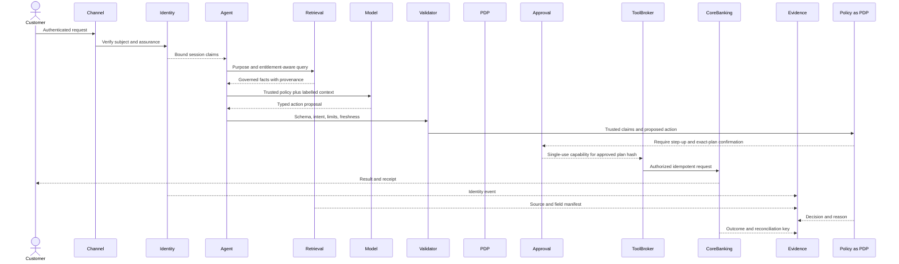

# Agentic AI in a regulated financial institution

## Scenario

A bank deploys a **Customer Service Action Agent** that can receive authenticated customer requests, retrieve customer and policy information, reason with an LLM, recommend actions, invoke enterprise APIs, and execute narrowly bounded transactions under controlled conditions.

Example request:

> Transfer 500 from my savings account to my own loan account and send a receipt.

> **PROPOSED MODEL — ORIGINAL IP:** The model may propose an action, but it never authorizes itself, receives standing transaction credentials, or directly executes a core-banking operation. Probabilistic reasoning ends at a **Deterministic Action Boundary**.

## Authority ladder

| Tier | Capability | Example | Approval boundary |
|---|---|---|---|
| A0 Generate/Observe | Produce output with no tool or state-changing access | Explain public product information | Content controls and disclosure; no transaction authority |
| A1 Read | Use approved read-only retrieval or APIs | Explain an authenticated customer's statement | Subject-, purpose-, resource-, and field-level authorization |
| A2 Recommend | Prepare advice; a human independently performs any action | Recommend a card freeze or transfer through the normal bank channel | Evidence, uncertainty, alternatives, and accountable human judgment |
| A3 Propose | Create an exact binding request for human approval | Prepare an exact own-account transfer plan | Exact-plan hash, fresh human approval, and backend reauthorization |
| A4 Bounded Execute | Execute a pre-authorized, reversible action within deterministic limits | Transfer between verified own accounts within approved limits | Step-up authentication, scoped identity, per-action policy, limits, idempotency, containment |
| A5 Delegated Autonomy | Dynamically select or delegate consequential actions | New-beneficiary payment, credit decision, KYC override, suspicious-activity disposition, or material complaint resolution | Prohibited in this scenario; human-controlled regulated process only |

The assigned tier is a ceiling. A session, tool, sub-agent, or peer agent cannot amplify it.

## Enterprise architecture views

### Business Architecture

Decisions:

- define permitted customer journeys, prohibited actions, agent-authority tiers, recourse, non-AI fallback, and accountable business executive;
- distinguish information, recommendation, proposal, and execution;
- define loss, complaint, unauthorized-action, access, and customer-harm tolerances; and
- preserve an accessible human service path.

Artifacts:

- capability and value-stream impact;
- customer journey and exception paths;
- decision-right and authority matrix;
- benefit, impact, and alternatives assessment; and
- service and risk measures.

### Data Architecture

Decisions:

- classify customer, account, transaction, policy, prompt, embedding, memory, and telemetry data;
- establish authoritative sources, permitted use, residency, retention, deletion, and lineage;
- enforce row-, field-, purpose-, jurisdiction-, and subject-level authorization before retrieval;
- admit content to the RAG corpus only through a governed ingestion process; and
- treat instructions found in retrieved documents, email, webpages, or tool output as untrusted data.

Controls:

- customer data remains in systems of record rather than an ungoverned vector-store master;
- each retrieved item retains source, version, owner, classification, and effective date;
- cross-session natural-language memory is disabled unless explicitly approved;
- structured session facts are preferred over unconstrained memory; and
- telemetry is minimized, redacted, classified, and retained according to purpose.

### Application Architecture

Separate services provide interaction, identity, reasoning, retrieval, policy, approval, tool brokering, execution, and evidence. The agent produces a typed proposal:

```json
{
  "intent": "internal_transfer",
  "source_account": "tokenized-account-ref",
  "destination_account": "tokenized-account-ref",
  "amount": 500,
  "currency": "approved-session-currency",
  "requires_step_up": true,
  "customer_confirmed_plan_hash": "sha256:...",
  "evidence_refs": ["policy:transfer-v17", "ownership-check:..."]
}
```

A deterministic validator checks identity, ownership, currency, amount, limits, fraud status, policy version, fresh confirmation, and idempotency. A model message cannot override a failed check.

### Technology Architecture

The deployment uses distinct security zones, workload and agent identities, short-lived scoped tokens, private connectivity, approved model endpoints, deny-by-default egress, signed artifacts, pinned versions, idempotent transactions, action/time/step budgets, observability, rollback, and kill switches.

No LLM receives unrestricted shell, browser, network, database, or core-banking credentials.

## Multi-agent extension

Each sub-agent receives a single-purpose capability containing:

- originating human or service principal;
- delegated agent identity and parent trace;
- permitted purpose and resources;
- tool/action allowlist and read/write level;
- maximum amount, action count, recursion depth, and expiry; and
- a prohibition on further delegation unless explicitly approved.

Peer-agent output is untrusted until validated. Sub-agents do not inherit standing credentials and cannot enlarge the originating subject's authority.

## Applying NIST AI RMF

### GOVERN

> **INTERPRETATION — DERIVED MAPPING:** Establish the institutional conditions under which the agent may exist.

- Inventory the system, models, prompts, RAG sources, tools, agents, providers, and owners.
- Classify it as consequential because it sees sensitive data and can change financial state.
- Define risk appetite, prohibited actions, agent-authority ceilings, human oversight, appeal, incident, deactivation, and decommissioning.
- Make a business executive accountable for customer and operational risk.
- Give Model Risk, Security, Privacy, Compliance, and Architecture independent challenge rights.
- Contract for provider change notification, incidents, evidence, data restrictions, portability, and fallback.

Outputs include the system record, risk classification, governance charter, accountability matrix, approved-use policy, supplier requirements, exception process, and incident/deactivation plan.

### MAP

> **INTERPRETATION — DERIVED MAPPING:** Define the actual socio-technical context rather than assess “agentic AI” in the abstract.

- Identify customers, contact-center staff, fraud operations, affected non-users, downstream systems, jurisdictions, and accessibility needs.
- Separate intended, foreseeable, misuse, and prohibited use.
- Map all data flows, trust boundaries, dependencies, handoffs, transaction finality, and customer recourse.
- Analyze prompt injection, poisoned retrieval, privilege amplification, identity confusion, tool misuse, duplicates, provider/model change, and delegation.
- Compare with a deterministic workflow or human-assisted alternative.

Outputs include the context profile, impact assessment, threat model, data-flow model, risk register, misuse cases, oversight design, and initial go/no-go decision.

### MEASURE

> **INTERPRETATION — DERIVED MAPPING:** Test the integrated system, not only the foundation model.

- Independently test task performance, grounding, authorization, privacy, fairness, oversight, resilience, prompt injection, RAG poisoning, tool abuse, and recovery.
- Test in deployment-like environments across repeated and multi-turn attempts.
- Measure successful outcomes and harmful side effects.
- Verify monitoring and policy enforcement independently from the model.

Outputs include the TEVV plan, evaluation corpus and provenance, model/system evaluation, red-team report, control-effectiveness evidence, limitations, and residual-risk assessment.

### MANAGE

> **INTERPRETATION — DERIVED MAPPING:** Make explicit deployment decisions and continually control exposure.

- Prioritize unauthorized transactions, confidentiality breach, identity failure, and unsafe agency above convenience measures.
- Progress from shadow mode to recommendation and then to narrow bounded action.
- Require named residual-risk acceptance, subject to mandatory independent dispositions.
- Bind approval to the exact models, prompts, policies, tools, indexes, and deployment context.
- Implement read-only fallback, human takeover, rollback, incident response, recourse, and emergency suspension.

Outputs include the treatment plan, signed release decision, staged rollout, residual-risk record, monitoring plan, incident playbook, exception expiry, and improvement backlog.

## Threat and control analysis

| Risk | Example attack/failure | Preventive architecture | Detection, response, and evidence |
|---|---|---|---|
| Prompt injection | User, RAG, email, web, or tool content changes objective | Trust labels; retrieved content is data; independent policy; constrained tools; no arbitrary egress; signed corpus | Direct/indirect multi-turn tests, blocked calls, source logs, attack-success measure, suspension on side effect |
| Data leakage | Another customer's data, prompts, secrets, or restricted documents disclosed | Pre-retrieval ABAC; tenant and field isolation; minimization; DLP; ephemeral memory; redaction | Seeded-secret and cross-customer tests, anomalous retrieval, DLP events, retrieved/disclosed field manifest |
| Excessive agency | Agent broadens task, loops, retries, or performs side effects | Action Envelope; deterministic state machine; step/time/cost/action/amount limits; no self-modification | Budget violations, unexpected sequences, retry patterns, kill-switch and compensation evidence |
| Confabulation | False policy, balance, eligibility, or transaction claim | Authoritative retrieval; citations; structured APIs; deterministic calculation; abstention | Grounding, faithfulness, completeness, policy-version tests, unsupported action-bearing claim rate |
| Unauthorized tool use | Agent selects unapproved tool or alters parameters | Signed registry; allowlist; typed schema; per-call PDP; single-use capability; backend reauthorization | Denials, schema failures, registry checks, API-to-plan correlation |
| IAM failure | Wrong principal, stale token, confused deputy, escalation | Bind human, workload, and agent identities; step-up; short-lived audience-bound token; separation of duties | Token replay, TOCTOU, identity substitution, revocation tests and correlated IAM/API logs |
| Drift | Model, provider, prompt, RAG, tool, or context changes behavior | Version pinning; material-change rules; regression gates; shadow/canary; rollback | Performance, refusal, grounding, policy violation, and distribution trends by digest |
| Harmful bias | Differential quality, escalation, accessibility, or outcomes | Representative requirements/testing; accessible alternative; no autonomous high-impact eligibility decision | Segment error, escalation, abandonment, complaint and qualitative impact review |
| Privacy violation | Excess collection, inference, incompatible use, over-retention | Purpose binding, minimization, notice/consent where applicable, deletion, encryption, isolation | Privacy attack tests, deletion proof, data-flow reconciliation, access and secondary-use alerts |
| Supply chain | Malicious/changed model, library, adapter, data, or service | Approved registry; signatures/hashes; SBOM/AIBOM; provenance; contracts; sandbox; fallback | Signature/provenance checks, advisories, provider drift tests, attestations, fallback exercises |
| Human oversight failure | Automation bias, unclear authority, unavailable or rubber-stamp reviewer | Clear ownership; source/uncertainty display; trained reviewer with authority/time; appeal; dual approval where needed | Human-factors simulations, override/detection rate, latency, disagreement and sampled outcomes |

## Assurance test program

Thresholds must be set by the institution. They are not NIST-prescribed.

| Test | Method | Release evidence |
|---|---|---|
| Action-authorization invariant | Property-based and adversarial sequences bypass confirmation, limits, policy, and broker | Zero unauthorized state change; backend independently rejects bypass; signed results and traces |
| Identity and TOCTOU | Change ownership, role, fraud state, and authentication between plan and execution; replay token | Current state is rechecked; stale/replayed authority denied |
| Agent hijacking | Direct/indirect injection in prompts, PDF, RAG, tool result, encoding, memory; repeated attempts | No unauthorized transaction or protected-data disclosure; benign-task degradation measured separately |
| RAG poisoning | Insert unsigned, stale, conflicting, hidden, and adversarial documents | Quarantine holds; claims identify approved source and version |
| Data leakage | Seed cross-customer records, canary secrets, restricted fields, exfiltration URLs | No seeded/cross-customer disclosure; prohibited raw content absent from logs |
| Grounding | Gold cases plus faithfulness, completeness, and sufficiency probes | Action-bearing claims cite current authoritative evidence or abstain/escalate |
| Tool misuse and agency | Request unapproved tools/parameters, recursion, retries, arbitrary network, excess action | Budgets and allowlists hold; no direct model-to-core path |
| Fairness and accessibility | Representative scenarios, subgroup analysis, accessible user research | Approved contextual thresholds; unexplained harmful disparity blocks release |
| Human oversight | Time pressure, misleading confidence, missing/conflicting evidence | Reviewer understands authority, detects error, overrides and escalates |
| Material change | Replace model, prompt, policy, index, provider, or tool schema independently | Unapproved digest cannot deploy; required regression and reapproval occur |
| Supply chain | Missing signature, stale BOM, vulnerable component, revoked provider | Admission fails safe; fallback exercised |
| Transaction resilience | Timeout, duplicate, partial failure, delayed response, partition | No duplicate booking; reconciliation and manual mode work |
| Multi-agent delegation | Privilege amplification, peer impersonation, replay, undeclared delegation, context poison | Subject chain and delegation ceiling preserved |
| Monitoring and kill switch | Simulate unauthorized action and control degradation | Alert, contain, preserve evidence, protect customer, and suspend within objective |

## Operational sequence



## Residual-risk position

Current model-layer defenses cannot guarantee that prompt injection or novel behavior will never succeed. The architecture therefore assumes that untrusted content can influence the model and limits the resulting blast radius with deterministic authorization, least privilege, narrow tools, exact-plan confirmation, transaction safety, continuous monitoring, and rapid suspension.

See [Control traceability](../control-traceability.md) for detailed worked chains and [Reference architecture](../reference-architecture.md) for component responsibilities.
