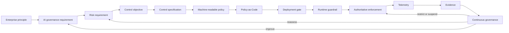
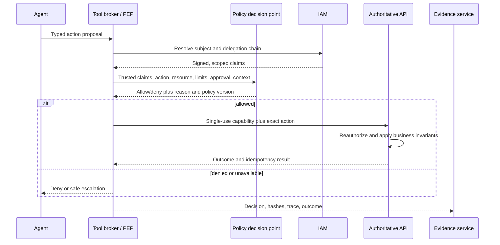

# Governance-as-Code and Policy-as-Code

## Definitions

> **PROPOSED MODEL — ORIGINAL IP:** **Governance-as-Code** is the broader operating system: machine-readable system, architecture, risk, control, decision, workflow, policy, evaluation, evidence, exception, and reauthorization data.

**Policy-as-Code** is a subset: executable decision logic evaluated against structured, trusted input.

A policy document converted to YAML is machine-readable governance, but not necessarily executable policy. A runtime guardrail is not automatically authorization. An evaluation score is not automatically assurance.

## Architecture-to-evidence progression

| Stage | Question | Example artifact |
|---|---|---|
| Enterprise Principle | What enduring enterprise intent applies? | “Material actions must be attributable and bounded.” |
| AI Governance Requirement | What outcome must this AI system satisfy? | “State-changing agents use scoped identity and approved authority.” |
| Risk Requirement | Which concrete scenario must be treated? | “Prevent an agent-initiated unauthorized transfer.” |
| Control Objective | What control outcome reduces the scenario? | “Deny actions outside verified intent, limits, or approval.” |
| Technical Control Specification | What trusted inputs, logic, output, failure mode, test, and evidence implement the objective? | Agent gateway control contract |
| Machine-Readable Policy | Which parameters and facts are structured? | Tool allowlist, amount limit, data class, approval age |
| Policy-as-Code | What executable rule returns a decision and reason? | Rego rule in the policy bundle |
| Deployment Gate | What blocks a non-conforming release? | Schema, trace, policy unit test, evaluation, signature, approval checks |
| Runtime Guardrail | What validates or transforms prompts, retrieval, tools, and output? | Injection detection, DLP, retrieval filtering, tool schema validation |
| Authoritative Enforcement | What component can actually deny the transaction or resource change? | API gateway, IAM, transaction service, admission controller |
| Telemetry | What observable facts report policy and control behavior? | Decision ID, subject chain, plan hash, reason, result, trace ID |
| Evidence | What preserved proof supports assurance? | Signed decision log, test result, provenance, operating-effectiveness sample |
| Continuous Governance | What response follows new evidence? | Reassess, restrict, expire exception, change threshold, suspend, retire |



## Control-contract schema

Each control contract defines:

```yaml
control_id: CTRL-AGENT-001
objective: Prevent an AI agent from executing an unauthorized state-changing action.
source_requirement_ids: [REQ-AUTH-001]
risk_ids: [RISK-AGENCY-001, RISK-IAM-002]
system_scope: [SYS-BANK-AGENT-001]
impact_tier: high
risk_tier: high
agent_authority: A4
control_owner: security-authorization-owner
operator: agent-platform-team
control_type: preventive
execution_mode: automated
lifecycle_point: runtime
enforcement_point: agent-tool-broker
trusted_inputs:
  - identity_claims_from_iam
  - approved_action_profile
  - transaction_state_from_core_service
  - exact_plan_approval_record
decision_logic: deny unless subject, purpose, action, resource, limits and approval all match
parameters:
  maximum_amount: 500
  approval_max_age_seconds: 120
expected_result: only the exact approved action can receive a single-use capability
test_method: property, boundary, replay, outage and adversarial sequence tests
evidence:
  schema: eaa-rif-control-evidence-v1
  frequency: every_decision
  retention: organization-defined
failure_behavior: fail_closed_and_escalate
dependencies: [IAM, policy-decision-point, transaction-api]
exception:
  allowed: false
version: 1.0.0
review_triggers: [identity_change, tool_change, incident, control_failure]
```

The machine-readable JSON Schema is in [`schemas/control-contract.schema.json`](../schemas/control-contract.schema.json).

## Where technologies fit

| Technology or category | Precise role | What it does not establish |
|---|---|---|
| **OPA / Rego** | Domain-neutral policy decisions in CI, admission, API gateways, or agent action gateways. Good for allowlists, trusted claims, classifications, limits, and exception state. | It does not authenticate users, measure hallucination, understand policy intent automatically, enforce the decision by itself, or prove compliance. OPA separates the policy decision point from the enforcement point. |
| **Azure Policy** | Azure management-plane resource configuration, such as approved regions/resource types, private networking, managed identity, diagnostics, and encryption. | It is not per-prompt content control, model evaluation, RAG governance, or transaction authorization. |
| **Terraform plan checks plus OPA/Sentinel/equivalent** | Detect non-conforming infrastructure intent before apply and preserve plan/gate evidence. | Plan-time checks cannot observe runtime model or agent behavior. |
| **CI/CD policy gates** | Orchestrate schema validation, trace completeness, policy tests, evaluation thresholds, supply-chain checks, signatures, and approvals. | The pipeline is not the risk owner or the control objective. A green build is scoped evidence, not general assurance. |
| **PyRIT** | Automated and human-led GenAI red teaming with repeatable attack scenarios, objectives, targets, scoring, and findings. | It is not a runtime control, complete threat model, or certification. |
| **NVIDIA NeMo Guardrails or equivalent** | Input, retrieval, dialog, execution/tool, and output rails around an LLM application. | It must not replace authoritative IAM, API authorization, or transaction checks. Its configuration and failure behavior require evaluation. |
| **LLM/agent evaluation frameworks** | Offline regression and online sampling for correctness, grounding, safety, tool selection, task completion, and domain metrics. | LLM-as-judge output is probabilistic, can share blind spots with the system, and cannot accept risk. |
| **SIEM/SOAR** | Correlate authorization failures, policy denials, unusual tool/data activity, control degradation, and incidents; drive response workflows. | It should not become an unrestricted raw-prompt archive or the sole assurance repository. |
| **OpenTelemetry and model/agent telemetry** | Correlate model, retrieval, orchestration, tool, policy, and outcome operations with stable identifiers. | Collecting all prompt content creates privacy, secret, retention, and cost risk. GenAI semantic conventions evolve and message/tool fields may be sensitive. |
| **Model/artifact registry and signing** | Bind version, digest, provenance, approval, integrity, and release. | Provenance alone does not show fitness, fairness, safety, or security. |
| **IAM, API gateway, tool broker, transaction service** | Authoritative authentication, scoped delegation, least privilege, rate/amount limits, and final business authorization. | These components must not trust an agent's self-asserted identity, intent, or approval. |

## OPA/Rego example

The repository includes a tested runtime deployment/action gate in [`examples/policy-as-code/opa/agent_deployment_gate.rego`](../examples/policy-as-code/opa/agent_deployment_gate.rego).

The important engineering rules are:

1. Rego receives claims from IAM, registries, approval services, and transaction systems, not from model-generated prose.
2. The policy returns an explicit allow decision and denial reasons.
3. The policy-enforcement point must fail closed or degrade safely when the decision service is unavailable.
4. The target API repeats authorization and business-rule validation.
5. The decision log records policy ID/version, trusted inputs or their hashes, decision, reasons, action hash, subject chain, and trace ID.
6. Unit tests cover allow, deny, missing input, stale approval, replay, limit boundaries, and service failure.

## Deployment gate

A high-consequence AI release should block when any required condition fails:

- system, architecture, risk, control, and evidence records fail schema validation;
- the assurance thread contains unresolved identifiers;
- policy code does not compile or policy unit tests fail;
- mandatory evaluation thresholds or attack invariants fail;
- model, prompt, RAG, tool, policy, or infrastructure digests are unapproved;
- required independent findings or residual-risk decisions are missing or expired;
- a critical control is degraded or failed;
- an exception is missing, expired, out of scope, or lacks dual-key approval; or
- evidence freshness no longer matches the release configuration.

Standard low-risk changes can pass automatically when policy explicitly delegates them. Material changes return to earlier gates.

## Runtime enforcement pattern



## Continuous evidence and change

Runtime evidence changes governance state only through explicit rules:

- a **warning threshold** increases sampling, review, or containment;
- a **control degradation threshold** restricts the affected capability;
- a **hard invariant failure** suspends the action path immediately;
- a **material configuration change** invalidates approval until required regression and authorization complete;
- an **expired exception** causes the underlying control to deny or the release gate to block; and
- a **pattern of complaints, overrides, near misses, or false denials** triggers contextual review even when technical metrics remain green.

## Limits of automation

Policy-as-Code works best for facts and decisions that are structured, authoritative, repeatable, and time-bounded. Human judgment remains essential for purpose legitimacy, affected-party impact, acceptable harm, fairness trade-offs, legal interpretation, adequacy of explanation, materiality, and residual-risk acceptance.

Automation can make governance faster and more observable. It can also create false precision. Every automated control therefore states its scope, uncertainty, dependencies, bypass paths, and failure behavior.
