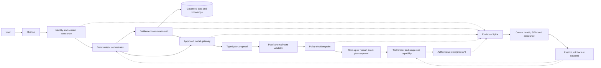

# Enterprise AI governance reference architecture

> **PROPOSED MODEL — ORIGINAL IP:** This reference architecture separates the value path, reasoning path, authority path, and evidence path. It applies to traditional ML, generative AI, RAG, and agentic systems with pattern-specific controls.

## Architecture planes

| Plane | Purpose | Representative components | Non-negotiable boundary |
|---|---|---|---|
| Business and experience | Deliver the use case and preserve customer/employee recourse | Channels, workflow, case management, human service, consent/notice | Business owner remains accountable for outcomes |
| Identity and authority | Establish who is acting, for what purpose, on which resource, with what delegation | IAM, workload/agent identity, token exchange, authorization, approval, separation of duties | Model text never creates identity or permission |
| Data and knowledge | Provide governed facts, features, training/evaluation data, documents, and lineage | Systems of record, data products, feature store, vector index, metadata, entitlement-aware retrieval | Authorization applies before retrieval; corpus is not an ungoverned master |
| Model and reasoning | Generate prediction, content, plan, or recommendation | Model gateway, model registry, prompt/configuration registry, orchestrator, agent runtime | Model output is untrusted until validated for the intended action |
| Control and enforcement | Apply deterministic and probabilistic controls at appropriate points | Policy decision points, plan validator, tool broker, API gateway, guardrails, DLP, rate/amount limits | Final authorization occurs in an authoritative service |
| Delivery and supply chain | Build, test, sign, promote, deploy, and roll back known configurations | Source control, CI/CD, evaluation suite, artifact registry, SBOM/AIBOM, IaC, signatures | Only approved digests and evidence can reach production |
| Observability and evidence | Correlate execution, policy, outcomes, and control health | OpenTelemetry-compatible traces, model/agent telemetry, SIEM, evidence store, risk/control registry | Sensitive content is minimized; evidence preserves provenance and integrity |
| Governance and assurance | Apply gates, independent challenge, risk decisions, reauthorization, audit | EAB, AIGB, MRM, Security, Privacy, Compliance, Data Governance, Internal Audit | Each authority records only its own decision |

## Pattern-specific extensions

> **SOURCE FRAMEWORK / INDUSTRY SYNTHESIS:** The risk themes below draw on [NIST AI RMF 1.0](https://doi.org/10.6028/NIST.AI.100-1), the [NIST Generative AI Profile](https://doi.org/10.6028/NIST.AI.600-1), [NIST AI 100-2e2025](https://doi.org/10.6028/NIST.AI.100-2e2025), [NIST agent-tool research](https://www.nist.gov/news-events/news/2025/08/lessons-learned-consortium-tool-use-agent-systems), and [MITRE ATLAS](https://atlas.mitre.org/). **ORIGINAL IP:** the EAA-RIF plane decomposition and placement of controls and evidence.

### Traditional ML

Primary risks include data quality/representativeness, feature leakage, model validity, drift, bias, privacy, adversarial input, and operational override.

Additional components:

- governed training and evaluation datasets;
- feature lineage and point-in-time correctness;
- model registry, validation status, and champion/challenger deployment;
- batch and online drift monitoring;
- explanation and decision-support interfaces appropriate to the context; and
- outcome reconciliation and override sampling.

### Generative AI application

Primary risks add confabulation, harmful content, information integrity/security, privacy leakage, IP, provider opacity, and human-AI configuration.

Additional components:

- prompt/system-instruction registry and approved configuration digests;
- model gateway with provider/model allowlist and request controls;
- input and output content protections;
- grounding/citation verifier where authoritative factual claims matter;
- evaluation suite covering task quality, safety, privacy, refusal, and robustness; and
- safe abstention and escalation.

### Retrieval-augmented generation

Primary risks add poisoned/stale content, unauthorized retrieval, misleading ranking, citation mismatch, and sensitive embeddings/caches.

Additional components:

- governed ingestion, malware/content scanning, ownership, classification, effective date, expiry, and quarantine;
- entitlement-aware query and pre-retrieval filtering;
- provenance-preserving chunks and source/version citations;
- retrieval quality, sufficiency, conflict, freshness, and leakage evaluation; and
- deletion and re-index evidence.

### Agentic and multi-agent systems

Primary risks add excessive agency, unauthorized tools, identity/delegation failure, indirect prompt injection, loops, resource exhaustion, cross-agent trust, and irreversible side effects.

Additional components:

- Agentic Action Envelope and `agent_authority` classification;
- deterministic orchestrator/state machine for consequential actions;
- typed plan and tool schemas;
- signed tool registry and tool broker;
- per-action policy and capability tokens;
- human exact-plan approval where required;
- step, time, cost, transaction, recursion, and delegation budgets;
- evidence of intent, subject chain, plan, decision, call, result, and outcome; and
- kill switch, read-only mode, compensation, and recovery.

## Agentic control flow

## Trust-Graded Context Envelope

| Context class | Examples | Trust treatment |
|---|---|---|
| T0 — platform policy | Signed system policy, tool registry, approved limits | Highest within scope; versioned and integrity-protected |
| T1 — verified subject facts | IAM claims, ownership, consent, current risk state | Accepted only from authoritative services; rechecked at execution |
| T2 — governed enterprise content | Approved policy/product document, data product, system-of-record response | Use with provenance, classification, effective date, and entitlement |
| T3 — user-provided content | User text, uploaded document, email | Treat as untrusted input; scan, isolate, never grant authority |
| T4 — external/tool content | Web content, third-party retrieval, tool result, peer-agent message | Treat as untrusted until verified; constrain rendering, egress, and follow-on actions |

Trust applies to origin and integrity, not truthfulness. A signed enterprise document can still be stale or wrong; a user statement can be accurate but cannot grant system authority.

## Evidence Spine event model

Each significant operation emits a linkable event with:

- `trace_id`, `span_id`, and `parent_span_id`;
- `system_id`, environment, configuration digest, and deployment ID;
- human/workload/agent subject chain and purpose;
- event type and lifecycle stage;
- model, prompt, corpus, tool, policy, and control versions where applicable;
- trusted input references or privacy-preserving hashes;
- decision, reason code, threshold/parameter version, and enforcement point;
- outcome, error/failure state, latency, and resource exposure;
- evidence classification, retention class, hash/signature, and producer; and
- linked risk, control, exception, gate, incident, and change identifiers.

Do not require hidden chain-of-thought as audit evidence. Preserve structured rationale, source citations, decisions, approvals, tool calls, policy results, and observable outcomes.

## Failure and safe-degradation matrix

| Failure | Default behavior for consequential action | Evidence/response |
|---|---|---|
| Identity or authorization unavailable | Deny or route to approved manual process | Record dependency failure and attempted action |
| Policy decision unavailable | Fail closed for writes; allow only explicitly approved read-only fallback | Alert control owner; preserve outage and fallback evidence |
| Model unavailable | Manual/deterministic fallback; never bypass authorization | Service degradation event and customer communication |
| Retrieval unavailable or insufficient | Abstain or use a clearly bounded non-personal deterministic response | Record source failure and abstention |
| Guardrail unavailable | Apply the pre-approved safe mode; for high-risk interaction stop rather than silently bypass | Control-health state changes to degraded/failed |
| Evidence service unavailable | Buffer integrity-protected minimum events or stop consequential action when auditability is mandatory | Reconcile buffered records and report gap |
| Evaluation or monitoring threshold breached | Restrict scope, increase human review, roll back, or suspend | Open incident/finding and trigger G6 |
| Duplicate or partial transaction | Idempotency and reconciliation; compensate under business rule | Record both attempt and final authoritative state |

## Architecture invariants

1. The model has no standing transaction credential.
2. Every state-changing action is a typed request bound to an authenticated subject, purpose, scope, and approved configuration.
3. The target service repeats authorization and business invariants.
4. Untrusted content cannot create authority.
5. A sub-agent cannot amplify delegated authority.
6. Every consequential action is traceable to intent, decision, approval where required, execution, and outcome.
7. A critical control failure produces safe degradation or suspension, not an undocumented bypass.
8. Material change invalidates affected evidence and invokes required regression and reauthorization.
