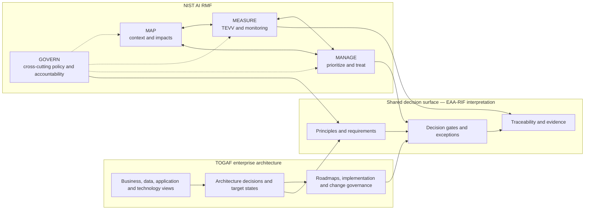
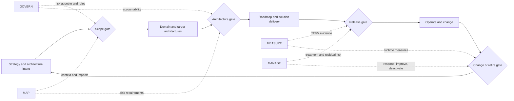
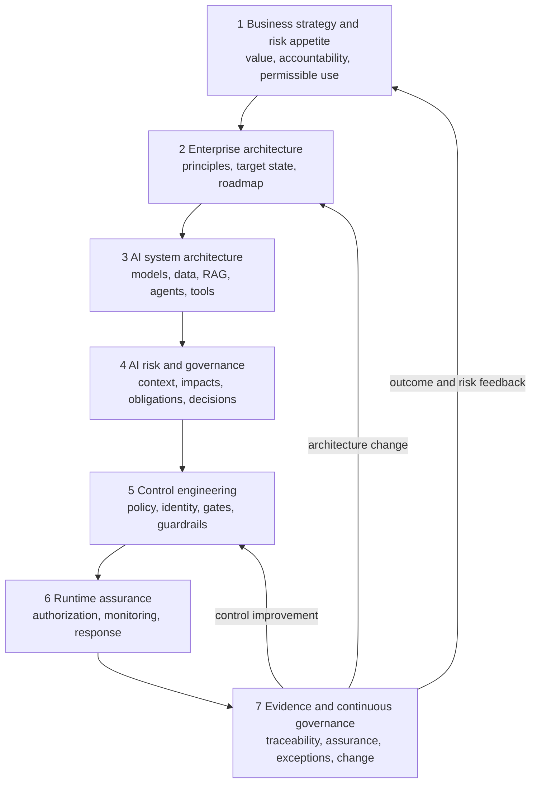
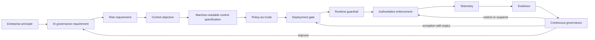
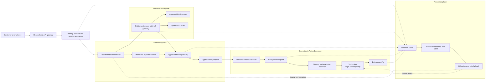
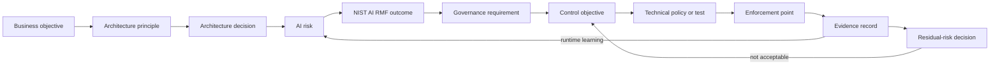
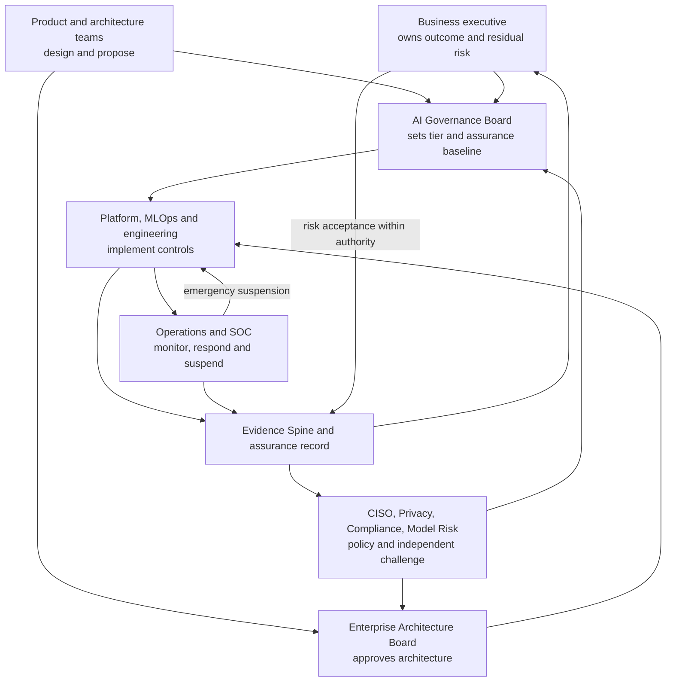
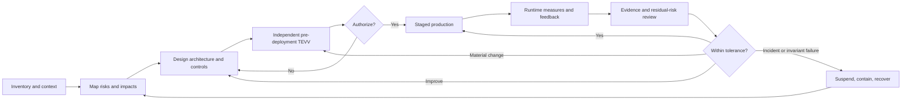

# Visual models

The diagram compositions and layouts are **PROPOSED MODEL — ORIGINAL IP**. TOGAF/ADM and NIST AI RMF names, domains, functions, and lifecycle concepts are **SOURCE FRAMEWORK**. Relationships between them are **DERIVED MAPPING** and are not official crosswalks. The diagrams use original layouts and do not reproduce proprietary TOGAF figures.

## 1. TOGAF versus NIST AI RMF

**Purpose:** Distinguish the two frameworks' centers of gravity while showing a legitimate shared decision surface.

**Components:** TOGAF enterprise-architecture lane; proposed shared decision surface; NIST AI RMF lane.

**Relationships:** Architecture decisions and change governance connect to principles, gates, and evidence; AI-risk functions connect to the same integration surface without becoming TOGAF phases.

**Recommended layout:** Three horizontal lanes with a narrow center bridge. Avoid overlapping circles that suggest equivalence.

## 2. How TOGAF and AI RMF intersect

**Purpose:** Show AI-risk activities informing architecture decisions without depicting AI RMF as a TOGAF phase sequence.

**Components:** Enterprise change lifecycle; scope, architecture, release, and change gates; four AI RMF functions.

**Relationships:** GOVERN and MAP inform early gates; MEASURE and MANAGE provide evidence and treatment at release and runtime; all may recur.

**Recommended layout:** Architecture lifecycle across the top, risk functions below, dotted links to decision gates.

## 3. Integrated enterprise AI governance architecture

**Purpose:** Connect business strategy to runtime evidence and feedback.

**Components:** Seven EAA-RIF layers.

**Relationships:** Downstream layers refine intent into executable governance; evidence feeds strategy, architecture, risk, and controls.

**Recommended layout:** Seven stacked horizontal bands with feedback arrows on the side. Treat the layers as coupled responsibilities, not a waterfall.

## 4. Governance-as-Code lifecycle

**Purpose:** Show how human policy intent becomes enforceable and how evidence closes the loop.

**Components:** Principle, governance requirement, risk requirement, control objective, machine-readable specification, policy code, deployment gate, runtime guardrail, authoritative enforcement, telemetry, evidence, governance decision.

**Relationships:** Each stage implements or evidences the prior stage; continuous governance improves or restricts the system.

**Recommended layout:** A left-to-right chain that returns to requirements and enforcement.

## 5. Agentic AI control architecture

**Purpose:** Make the Deterministic Action Boundary and Evidence Spine visible.

**Components:** Channel, identity, deterministic orchestrator, reasoning plane, governed data plane, action boundary, assurance plane.

**Relationships:** The reasoning plane proposes; data access is entitlement-aware; the action boundary validates and authorizes; evidence correlates every stage; monitoring can disable orchestration or writes.

**Recommended layout:** Left-to-right request flow with three horizontal planes and a prominent vertical action boundary before enterprise APIs.

## 6. Control traceability chain

**Purpose:** Show how a business objective becomes a defensible residual-risk decision.

**Components:** Objective, principle, decision, risk, framework outcome, governance requirement, control, policy, enforcement, evidence, residual risk.

**Relationships:** Each node traces forward to implementation and backward to intent; runtime evidence can reopen the risk.

**Recommended layout:** A single horizontal chain with a feedback arrow from evidence/residual risk to the risk and control.

## 7. Enterprise decision-rights model

**Purpose:** Separate design, governance, implementation, monitoring, assurance, and risk acceptance.

**Components:** Business owner, EAB, AIGB, independent risk functions, product/architecture, engineering, operations, and evidence service.

**Relationships:** Teams propose and implement; boards decide within scope; evidence flows to independent challenge and the business owner; operations may suspend.

**Recommended layout:** Governance authorities at the top, design/engineering in the middle, operations/evidence at the bottom. Use distinct decision arrows.

## 8. Continuous AI assurance feedback loop

**Purpose:** Show authorization as a time-bound state maintained by evidence, not a one-time approval.

**Components:** Inventory/context, risk mapping, architecture/control design, independent TEVV, authorization, staged production, runtime measures, evidence review, improvement or suspension.

**Relationships:** Failed pre-production evidence returns to design; runtime evidence can continue, improve, revalidate, or suspend.

**Recommended layout:** Circular or left-to-right loop with a clearly marked authorization decision and incident branch.

## Rendering guidance

- Use the source labels in captions when diagrams appear outside this repository.
- Keep TOGAF and NIST names as text references; do not copy protected logos or source diagrams unless separately licensed.
- In decks, use native editable shapes for the required architecture diagrams.
- In code repositories, Mermaid is the canonical portable representation.
- Preserve the distinction between dotted informational relationships and solid control/decision paths.
