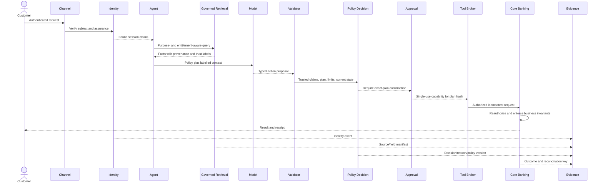
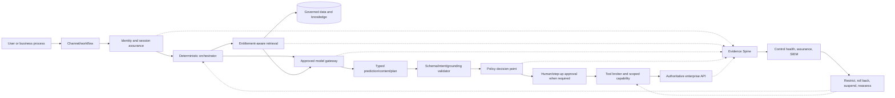
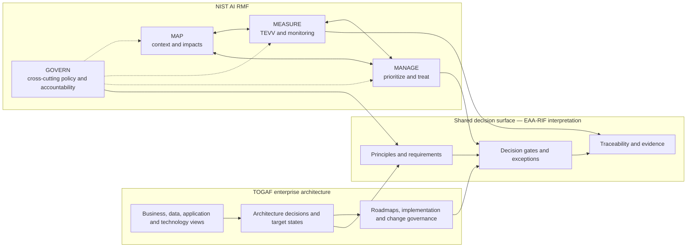
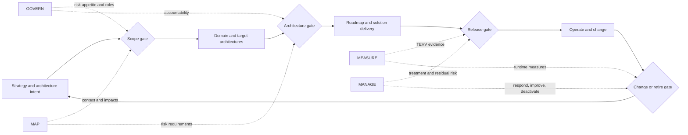
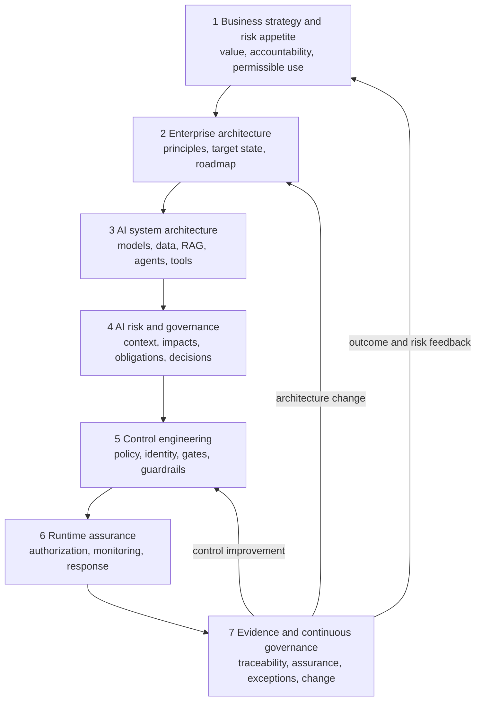
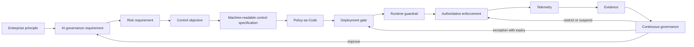
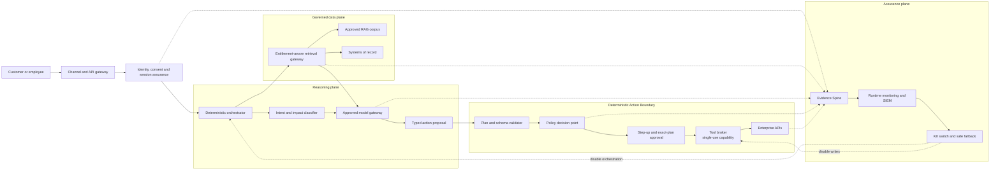
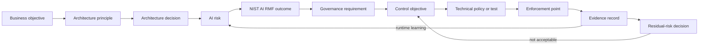
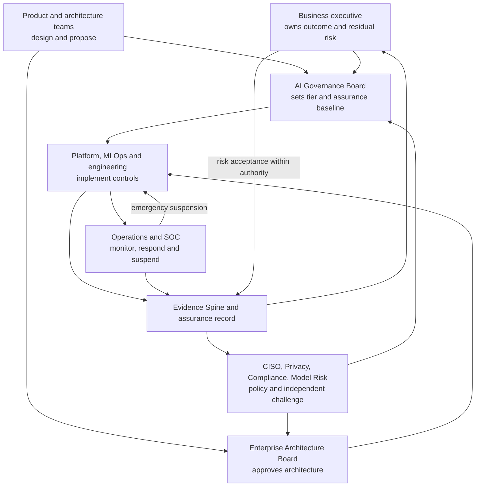
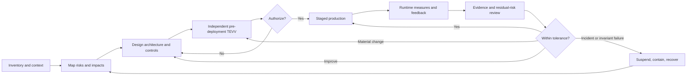

# EAA-RIF: Enterprise AI Architecture & Risk Integration Framework

## Architecture-to-Evidence (A2E) for Traditional, Generative, and Agentic AI

**Version:** 0.1.0

**Research baseline:** 9 November 2026

**Status:** Original, vendor-neutral reference framework and implementation playbook

> **Central question:** How can an enterprise connect architecture decisions, AI risks, enforceable controls, runtime evidence, and continuous governance into one traceable operating model?

EAA-RIF answers with a versioned **Architecture-to-Evidence (A2E)** assurance thread:

`business objective -> architecture decision -> AI risk -> requirement -> control -> policy/test -> enforcement -> evidence -> residual-risk decision -> change trigger`

This paper uses two complementary label sets:

- **FACT** identifies a sourced statement about an external framework or standard.
- **INTERPRETATION** identifies EAA-RIF analysis, including a non-official relationship or mapping.
- **PROPOSED MODEL** identifies a design proposed by EAA-RIF.
- **SOURCE FRAMEWORK** identifies third-party concepts that remain their owners' intellectual property.
- **DERIVED MAPPING** identifies an EAA-RIF interpretation relating source concepts.
- **ORIGINAL IP** identifies the integrated EAA-RIF method, schemas, patterns, and implementation assets.

No part of this paper claims that NIST AI RMF is formally part of TOGAF, or that The Open Group or NIST has approved the mappings. It contains original summaries and diagrams rather than reproduced TOGAF text or figures.

---

## 1. Executive Summary

### The answer in one paragraph

> **PROPOSED MODEL — ORIGINAL IP:** An enterprise should connect AI architecture and AI risk through a versioned governance graph. Enterprise architecture establishes purpose, boundaries, target state, dependencies, and change. AI risk management establishes context, risk, measurement, treatment, and accountability. Control engineering translates accepted requirements into deterministic policies, probabilistic evaluations, procedural controls, and authoritative enforcement points. Runtime systems produce evidence linked to the exact system configuration. Named authorities then use that evidence to authorize, restrict, redesign, suspend, or retire the system.

EAA-RIF is not a new compliance badge and not a forced TOGAF-to-NIST crosswalk. It is an integration overlay comprising:

1. seven coupled operating layers from strategy through continuous evidence;
2. seven governance and assurance gates with distinct decision rights;
3. an A2E assurance graph with stable identifiers and completeness rules;
4. control contracts that specify enforcement, tests, evidence, and failure behavior;
5. reference control patterns for traditional ML, GenAI, RAG, agents, and multi-agent systems;
6. a Governance-as-Code model that includes decisions, exceptions, evidence, and reauthorization—not only policy syntax; and
7. reusable templates, schemas, maturity measures, and an implementation roadmap.

The design deliberately keeps four decisions separate:

- architecture approval: is the target state coherent and conformant?
- domain control approval: does the control design meet a security, privacy, data, legal, model-risk, or operational requirement?
- assurance conclusion: does current evidence support a claim for this version and context?
- residual-risk acceptance: does the accountable business risk owner accept the remaining exposure within delegated authority?

**FACT — SOURCE FRAMEWORK:** The [TOGAF Standard](https://help.opengroup.org/hc/en-us/articles/32726995273362-Understanding-the-TOGAF-Standard) provides an enterprise architecture method, content concepts, and architecture capability/governance guidance. The [NIST AI RMF 1.0](https://doi.org/10.6028/NIST.AI.100-1) provides voluntary AI-risk outcomes organized around GOVERN, MAP, MEASURE, and MANAGE. NIST describes the functions as iterative and non-sequential, not a checklist.

The source baseline is version-pinned. The [official NIST AI RMF page](https://www.nist.gov/itl/ai-risk-management-framework) states that AI RMF 1.0 is being revised; a revised publication must trigger an EAA-RIF mapping impact assessment rather than silently replacing historical decisions.

---

## 2. Problem Statement

Enterprise AI programs commonly separate activities that need to remain traceable:

- architects choose platforms, data flows, integration patterns, models, and target states;
- risk teams record risks and policies;
- engineers implement controls in infrastructure, pipelines, applications, and APIs;
- evaluation teams test model and system behavior;
- operations observe incidents and drift; and
- executives approve deployment or accept residual risk.

The result is often a collection of unlinked slide decks, registers, tickets, policy files, dashboards, and approval emails. The organization cannot reliably answer:

- Which architecture decision created or reduced this risk?
- Which control implements the requirement, and where is it actually enforced?
- Is the evidence current for the deployed model, prompt, corpus, tool, and policy versions?
- Which person can approve architecture, grant an exception, authorize release, or accept residual risk?
- What runtime event invalidates the original decision?

Traditional ML already requires lineage, model validation, security, fairness, monitoring, and override. GenAI adds confabulation, information integrity, provider opacity, prompt injection, and content risk. RAG adds corpus authorization, provenance, poisoning, freshness, and deletion concerns. Agentic systems add tools, identity delegation, planning, memory, excessive agency, resource loops, and external side effects. Multi-agent systems add peer trust, privilege amplification, causal ambiguity, and emergent coordination.

### Design objectives

EAA-RIF must be:

- vendor-neutral and usable across cloud, on-premises, and hybrid estates;
- architecture-led without making architects the owners of every risk;
- risk-aware without turning NIST AI RMF into a project methodology;
- technically enforceable where a decision is codifiable;
- explicit where judgment cannot be automated;
- scalable by impact tier, risk tier, agent authority, and change class;
- evidence-driven rather than artifact-count driven; and
- suitable for enterprise architects, AI architects, risk teams, CISOs, product owners, engineers, operators, validators, and auditors.

### Non-goals

EAA-RIF does not certify conformance to TOGAF, NIST AI RMF, ISO/IEC 42001, ISO/IEC 23894, law, or regulation. It does not prescribe universal risk scores, fairness metrics, or release thresholds. It does not replace enterprise risk management, cybersecurity, privacy, legal analysis, model-risk management, quality, safety, or internal audit.

---

## 3. TOGAF Explained

### 3.1 What TOGAF is

**FACT — SOURCE FRAMEWORK:** TOGAF is The Open Group's standard for enterprise architecture. Its public overview describes fundamental content covering core concepts, the Architecture Development Method (ADM), architecture techniques, content, and the capability and governance needed to operate enterprise architecture, supplemented by contextual Series Guides. See [Understanding the TOGAF Standard](https://help.opengroup.org/hc/en-us/articles/32726995273362-Understanding-the-TOGAF-Standard).

From first principles, enterprise architecture answers four connected questions:

1. What outcomes and capabilities does the enterprise need?
2. What present-state structures and constraints shape the change?
3. What target business, data, application, and technology state should exist?
4. How will the enterprise govern migration, implementation, and subsequent change?

Organizations use TOGAF because large transformations cross business units, data domains, platforms, suppliers, jurisdictions, and delivery programs. Local optimization can otherwise create duplicate capabilities, incompatible data, uncontrolled dependencies, fragile transitions, and technology that does not support the business strategy.

### 3.2 Architecture Development Method

**FACT — SOURCE FRAMEWORK:** TOGAF's ADM is iterative and tailorable. Public Open Group materials describe preparation, Architecture Vision, Business/Data/Application/Technology Architectures, solution and migration planning, implementation governance, architecture change, and continuous requirements work. See the official [TOGAF practitioner competency mapping](https://help.opengroup.org/hc/en-us/articles/32127544219026-Competency-to-Role-Mapping-TOGAF-Enterprise-Architecture-Practitioner) and [TOGAF–ArchiMate relationship overview](https://help.opengroup.org/hc/en-us/articles/32115987894930-How-the-ArchiMate-Language-and-the-TOGAF-Standard-Complement-Each-Other).

The phase and activity names below are **SOURCE FRAMEWORK**; the enterprise questions and result summaries are EAA-RIF paraphrase. No proprietary TOGAF diagram or template is reproduced.

An original, concise interpretation of the method is:

| ADM activity | Enterprise question | Typical architecture result |
|---|---|---|
| Preliminary work | How will architecture be governed, tailored, staffed, and connected to strategy and delivery? | Capability, principles, governance, repository conventions |
| Architecture Vision | What change, value, scope, stakeholders, constraints, and approval are involved? | Vision, scope, stakeholders, initial risks and decision |
| Business Architecture | What capabilities, value streams, processes, organization, and decision rights are required? | Baseline/target business views and gaps |
| Data Architecture | What information, ownership, quality, flow, lifecycle, and protection are required? | Baseline/target data views, lineage, gaps |
| Application Architecture | What services, applications, interactions, and responsibilities realize the capabilities? | Application/service portfolio, interfaces, gaps |
| Technology Architecture | What platforms, infrastructure, networks, runtime services, and standards support the solution? | Technology target state, standards, gaps |
| Opportunities and Solutions | What solution building blocks and transition states can realize the target? | Work packages, transition architectures, solution choices |
| Migration Planning | In what sequence, with what dependencies, cost, value, and risk should change occur? | Prioritized roadmap and migration plan |
| Implementation Governance | Does delivery conform to the approved architecture, and how are deviations handled? | Conformance findings, decisions, exceptions |
| Architecture Change Management | Has strategy, environment, technology, risk, or implementation changed enough to require adaptation? | Change decision, refreshed architecture, new cycle |
| Requirements Management | Are requirements traceable, current, reconciled, and available throughout the work? | Managed requirement set and impact links |

This is a method for disciplined change, not a demand to produce every possible artifact in a fixed sequence.

### 3.3 Architecture principles

Architecture principles are durable decision rules. For enterprise AI, original examples include:

- authoritative enterprise data is accessed through governed products and services;
- probabilistic output does not create identity, permission, or transaction authority;
- every material AI component and decision is attributable and versioned;
- consequential actions degrade safely when critical controls are unavailable;
- use shared capabilities unless a justified exception produces better enterprise value; and
- architecture approvals are bound to an intended use and operating context.

Principles become useful when they constrain an actual decision, have an accountable owner, define implications, and are tested through governance.

### 3.4 The four architecture domains

- **Business Architecture:** strategy, capability, process, organization, value, customer/employee journey, accountability, and operating model.
- **Data Architecture:** information concepts, sources, ownership, lineage, quality, access, lifecycle, residency, and exchange.
- **Application Architecture:** services, applications, interfaces, responsibilities, interactions, and rationalization.
- **Technology Architecture:** platforms, infrastructure, networks, compute, runtime, observability, resilience, and technical standards.

AI is not best treated as a fifth isolated domain. It changes and depends on all four: business decisions and human work, data and knowledge, applications and APIs, and technology/platform services.

### 3.5 Architecture governance, repository, and change

**FACT — SOURCE FRAMEWORK:** TOGAF includes architecture governance and an architecture repository/content approach. EAA-RIF summarizes these concepts without reproducing official templates.

- Architecture governance assigns authority for direction, conformance, exceptions, and change.
- The architecture repository preserves principles, reference architectures, standards, reusable building blocks, decisions, roadmaps, and governed architecture descriptions.
- Requirements management maintains traceability as architecture and delivery evolve.
- Implementation governance checks whether delivered systems conform to architecture; it is not a substitute for software testing or AI assurance.
- Architecture change management evaluates whether operational evidence, external change, or implementation reality requires a localized change or a new architecture cycle.

### 3.6 Global-bank GenAI and agentic platform example

A global bank wants one enterprise platform supporting employee copilots, customer-service RAG, software assistants, fraud investigation, and bounded customer-service agents.

| Architecture activity | Bank decision and result |
|---|---|
| Preliminary | Establish AI architecture principles, EA/AIGB decision rights, model/data/tool catalogs, source-version rules, and a reusable control/evidence capability. |
| Vision | Define business outcomes, excluded use cases, jurisdictions, stakeholders, cost/value hypotheses, risk appetite, and whether a common platform is justified. |
| Business | Identify service journeys, roles, human handoffs, affected customers, complaint/appeal paths, agent-authority ceilings, and business ownership. |
| Data | Classify prompts, customer records, policies, embeddings, telemetry, and memory; define lineage, purpose, retention, residency, corpus admission, and entitlement-aware retrieval. |
| Application | Separate channels, orchestrators, retrieval, model gateway, policy service, tool broker, approval service, enterprise APIs, case management, and evidence services. |
| Technology | Select approved model endpoints, workload identities, network zones, encryption, private connectivity, isolation, signing, monitoring, availability, and fallback patterns. |
| Opportunities/Solutions | Compare build, buy, managed service, and hybrid options; define reusable platform services and transition architectures from pilots to controlled production. |
| Migration | Sequence low-impact assistants before customer-facing or state-changing agents; prioritize shared IAM, retrieval governance, evaluation, telemetry, and kill-switch capabilities. |
| Implementation governance | Check each product against the approved patterns and decisions while leaving security testing, privacy assessment, and model validation to their authorities. |
| Change | Reassess when models, providers, prompts, corpora, tools, users, geography, `agent_authority`, regulation, or observed outcomes materially change. |

TOGAF gives this program an enterprise change spine. It does not by itself define GenAI trustworthiness measures, attack tests, fairness evaluation, or residual AI-risk treatment; those require complementary risk and assurance work.

---

## 4. NIST AI RMF Explained

### 4.1 What NIST AI RMF is

**FACT — SOURCE FRAMEWORK:** [NIST AI RMF 1.0](https://doi.org/10.6028/NIST.AI.100-1) is a voluntary, rights-preserving, non-sector-specific framework intended to help organizations manage risks to individuals, organizations, and society and incorporate trustworthiness into AI design, development, deployment, use, and evaluation.

The framework describes trustworthy AI characteristics including validity and reliability, safety, security and resilience, accountability and transparency, explainability and interpretability, privacy enhancement, and fairness with harmful bias managed. These characteristics can conflict; context and risk tolerance matter.

The [NIST AI RMF Playbook](https://airc.nist.gov/airmf-resources/playbook/) provides voluntary suggested actions aligned to Core outcomes. It is neither a mandatory checklist nor an ordered project plan. The [NIST Generative AI Profile](https://doi.org/10.6028/NIST.AI.600-1) extends AI RMF analysis for GenAI risks and actions.

### 4.2 The four functions

| Function | Independent meaning | Enterprise implementation examples |
|---|---|---|
| **GOVERN** | Establish culture, policy, accountability, roles, risk tolerance, inventory, lifecycle practices, third-party governance, and continual improvement | AI policy, ownership, impact tiers, competence, issue escalation, supplier terms, documentation, decommissioning |
| **MAP** | Establish intended and actual context, affected parties, benefits, harms, dependencies, limitations, and risk scenarios | Context profile, impact assessment, system boundary, misuse cases, data/tool/provider dependency map, non-AI alternative |
| **MEASURE** | Use quantitative, qualitative, or mixed methods to analyze, test, evaluate, verify, validate, and monitor risks and trustworthiness | Performance/fairness/security/privacy tests, red teaming, uncertainty, human-factors tests, drift and outcome monitoring |
| **MANAGE** | Prioritize risk, select treatment, allocate resources, decide whether and how to proceed, respond to incidents, monitor, improve, restrict, or retire | Avoid/reduce/transfer/accept decisions, staged release, limits, fallback, incident response, residual risk, deactivation |

GOVERN is cross-cutting. MAP, MEASURE, and MANAGE recur as purpose, data, system, users, threats, and evidence change.

### 4.3 Key risk-management concepts

- **Governance and accountability:** name policy owners, system owners, risk owners, validators, operators, and decision authorities; preserve separation of duties.
- **Risk identification:** describe a cause–event–impact scenario in deployment context rather than record labels such as “bias” or “hallucination.”
- **Measurement:** combine technical metrics, qualitative evidence, stakeholder input, uncertainty, coverage, and deployment-relevant testing.
- **Risk treatment:** avoid, reduce, share/transfer where meaningful, or accept within authority; consider non-AI alternatives and retirement.
- **Transparency and accountability:** document intended use, limitations, provenance, decisions, controls, evidence, incidents, and responsible parties.
- **Explainability and interpretability:** select methods appropriate to the decision and audience; an explanation that does not support oversight or recourse may be technically plausible but operationally inadequate.
- **Fairness:** evaluate relevant groups, processes, errors, access, outcomes, and recourse; no universal metric resolves all contextual trade-offs.
- **Privacy:** address collection, inference, purpose, access, retention, disclosure, deletion, and telemetry—not only model training data.
- **Robustness, security, and resilience:** test normal, adverse, manipulated, degraded, and recovery states; maintain safe fallback.
- **Monitoring:** watch model/system behavior, context, complaints, overrides, incidents, third parties, control health, and emergent risk.

### 4.4 Application across AI patterns

| Pattern | MAP emphasis | MEASURE emphasis | MANAGE emphasis |
|---|---|---|---|
| Traditional predictive ML | Decision context, features, population, affected parties, feedback loop | Validity, calibration, subgroup error, leakage, drift, adversarial input, override | Use limits, human review, retraining, challenger, appeal, suspension |
| Generative AI | Intended content use, users, provider/data dependencies, foreseeable misuse | Factuality, harmful content, privacy, security, robustness, refusal, human reliance | Grounding, disclosure, use restrictions, abstention, provider fallback, monitoring |
| LLM application | Full application boundary, prompt/configuration, connected services, human workflow | End-to-end task quality and safety rather than foundation-model score alone | Configuration binding, release gate, rollback, operational limits |
| RAG | Corpus ownership, entitlement, provenance, freshness, retrieval and citation flow | Retrieval quality, poisoning, leakage, conflict, citation support, deletion | Governed ingestion, pre-retrieval authorization, quarantine, expiry, re-index and source withdrawal |
| AI agent | Goal, memory, tools, identity, authority, environment, reversibility, human control | Tool selection, argument validity, injection, loops, budgets, authorization, oversight, recovery | Authority ceiling, per-action policy, exact-plan approval, tool broker, kill switch, compensation |
| Multi-agent system | Delegation topology, peer trust, shared state, emergent coordination, responsibility | Privilege amplification, peer impersonation, causal trace, recursion, collusion-like behavior | Constrained delegation, isolation, resource ceilings, cross-agent policy, rapid containment |

#### Short examples

- A credit-risk model requires outcome validity, subgroup analysis, model-risk validation, drift monitoring, adverse-action processes, and accountable credit policy.
- A GenAI policy assistant requires current governed sources, grounded answers, disclosure, privacy controls, abstention, and monitored corrections.
- A RAG service must authorize a document before it enters model context; output filtering alone cannot reliably undo unauthorized retrieval.
- A transaction agent requires typed plans, scoped identity, deterministic authorization, fresh approval, idempotency, reconciliation, and complete evidence.
- A multi-agent research workflow requires each sub-agent to inherit no more authority than the originating subject and approved purpose.

---

## 5. Differences

### 5.1 Rigorous comparison

| Dimension | TOGAF — FACT / SOURCE FRAMEWORK | NIST AI RMF — FACT / SOURCE FRAMEWORK | INTERPRETATION |
|---|---|---|---|
| Purpose | Develop, govern, and evolve enterprise architecture | Manage AI risk and support trustworthy AI | TOGAF asks what enterprise change and target state are needed; AI RMF asks what AI risk exists, how it is evidenced, and what response is justified |
| Scope | Strategy and Business, Data, Application, and Technology architecture; implementation and change | AI systems, actors, lifecycle, context, benefits, harms, and trustworthiness | AI risk crosses all architecture domains; it is not an isolated architecture domain |
| Primary stakeholders | Sponsors, architects, portfolio/transformation, delivery, architecture governance | Designers, developers, deployers, operators, acquirers, evaluators, risk functions, users, affected communities | Link forums while retaining distinct accountability |
| Lifecycle | Tailorable, iterative ADM from capability and vision through migration, implementation, and change | Iterative GOVERN/MAP/MEASURE/MANAGE across AI lifecycles | Never draw four NIST functions as four sequential ADM phases |
| Governance | Architecture capability, principles, content, repository, conformance, implementation, change | Risk culture, policies, accountability, tolerance, inventory, stakeholder and third-party governance | Overlap exists, but decision objects differ |
| Architecture emphasis | Strong baseline/target state, dependency, building-block, and roadmap focus | No prescribed target-architecture method | TOGAF supplies structural design and enterprise change discipline |
| Risk emphasis | Risk can inform architecture, but TOGAF is not an AI-risk taxonomy or TEVV method | AI risk, impact, trustworthiness, measurement, treatment, and residual risk are central | AI RMF supplies risk outcomes and assurance expectations |
| Artifacts | Architecture views, requirements, decisions, roadmaps, migration and governance records | Outcome-oriented inventories, risk/impact records, measurements, monitoring, response, documentation | Link artifacts with stable IDs rather than merge repositories |
| Decision mechanisms | Scope, target-state selection, roadmap, conformance, exception, change | Risk tolerance, treatment, go/no-go, monitoring, incident response, deactivation | A joint gate records separate decisions |
| Technical controls | Does not prescribe AI-specific control technologies | Also non-prescriptive and outcome-oriented | EAA-RIF adds control engineering and evidence contracts |
| Assurance | Architecture conformance and implementation oversight | TEVV, measurement, independent assessment where appropriate | Architecture review is not model/system validation |
| Continuous monitoring | Requirements and architecture change sustain target state | Ongoing measurement, emergent risk, incident response, improvement | Runtime evidence can trigger both risk treatment and architecture change |
| Compliance | Useful structure, not AI legal compliance | Voluntary framework, not legal compliance | Map actual obligations separately and obtain authoritative legal/compliance judgment |

### 5.2 Direct answers

**What TOGAF solves that NIST AI RMF does not:** strategy-to-capability alignment; coherent enterprise target states; cross-domain dependencies; application/data/platform rationalization; transition architectures; roadmap and migration sequencing; architecture governance, conformance, repository, and architecture change.

**What NIST AI RMF solves that TOGAF does not:** AI-specific trustworthiness and harm framing; socio-technical context; AI testing, evaluation, verification, and validation; risk tolerance and treatment; residual-risk documentation; affected-party considerations; emergent risk; AI third-party and supply-chain risk; GenAI-specific risk guidance.

**Where they overlap:** governance, accountability, stakeholders, requirements, documentation, monitoring, change, suppliers, and risk-informed decision-making.

**Where they should remain separate:** architecture approval from residual-risk acceptance; architecture conformance from independent validation; architecture repositories from raw telemetry/evidence stores; AI-risk outcomes from detailed security threat/control methods; and human judgments from automated gates.

---

## 6. Relationship and Mapping

### 6.1 Integration hypothesis

> **INTERPRETATION — DERIVED MAPPING:** TOGAF can provide the enterprise change and architecture lifecycle within which AI initiatives are designed and governed. NIST AI RMF can provide a cross-cutting AI-risk loop that informs architecture requirements, solution choices, implementation evidence, production decisions, and change. NIST AI RMF is not formally part of TOGAF.

### 6.2 Classification method

- **DIRECT:** substantially the same practical outcome is addressed, although terminology and scope may differ.
- **COMPLEMENTARY:** outputs from one materially enable the other, but the activities remain distinct.
- **WEAK:** a contextual or occasional relationship exists; treating it as a primary mapping would mislead.
- **NO MEANINGFUL MAPPING:** the activity does not materially implement the function; forcing a link creates false precision.

### 6.3 ADM activity to NIST function matrix

Every cell is an **INTERPRETATION — DERIVED MAPPING**, not an official crosswalk.

| TOGAF activity | GOVERN | MAP | MEASURE | MANAGE |
|---|---|---|---|---|
| Preliminary capability, tailoring, principles | **DIRECT:** establishes governance capability, roles, principles | **COMPLEMENTARY:** supplies enterprise scope/taxonomy | **NO MEANINGFUL MAPPING:** no system TEVV | **WEAK:** enables resources but does not treat a system risk |
| Architecture Vision | **COMPLEMENTARY:** sponsorship, stakeholders, principles | **DIRECT:** purpose, context, affected parties, constraints | **COMPLEMENTARY:** success/harm criteria seed assurance | **COMPLEMENTARY:** constraints shape treatment choices |
| Business Architecture | **COMPLEMENTARY:** operating model and accountability | **DIRECT:** processes, actors, benefits, harms, oversight context | **COMPLEMENTARY:** business outcome/harm indicators | **COMPLEMENTARY:** process controls and non-AI alternatives |
| Data Architecture | **COMPLEMENTARY:** ownership, policy, supplier accountability | **DIRECT:** sources, provenance, subjects, uses, dependencies | **COMPLEMENTARY:** defines data-quality, representativeness, privacy, bias, and drift requirements/evidence hooks; it does not itself perform AI TEVV | **COMPLEMENTARY:** access, lineage, retention, remediation controls |
| Application Architecture | **COMPLEMENTARY:** application ownership and standards | **DIRECT:** system boundary, components, interfaces, users | **COMPLEMENTARY:** places model/RAG/agent/tool evaluation points; independent assurance performs the evaluation | **COMPLEMENTARY:** mediation, approval, authorization, containment |
| Technology Architecture | **COMPLEMENTARY:** platform and supply governance | **COMPLEMENTARY:** deployment context and infrastructure dependencies | **COMPLEMENTARY:** telemetry, resilience, security, testability | **COMPLEMENTARY:** IAM, isolation, fail-safe, recovery mechanisms |
| Opportunities and Solutions | **COMPLEMENTARY:** policy constrains options | **WEAK:** options may add context, but mapping should exist earlier | **COMPLEMENTARY:** evidence compares options/controls | **DIRECT:** selects treatment work packages and alternatives |
| Migration Planning | **COMPLEMENTARY:** funding and authority | **WEAK:** migration can change context | **COMPLEMENTARY:** evidence informs priority | **DIRECT:** sequences and resources treatment |
| Implementation Governance | **DIRECT:** oversight, conformance, exceptions | **COMPLEMENTARY:** implementation change may require remapping | **COMPLEMENTARY:** consumes TEVV; does not replace it | **DIRECT:** enforces treatment conditions and escalation |
| Architecture Change | **DIRECT:** continuing accountability/change policy | **COMPLEMENTARY:** use/context change triggers new MAP work | **COMPLEMENTARY:** evidence triggers change | **DIRECT:** improve, restrict, respond, or retire |
| Continuous Requirements | **COMPLEMENTARY:** policy becomes requirement | **COMPLEMENTARY:** mapped risk becomes requirement | **COMPLEMENTARY:** metrics become acceptance criteria | **COMPLEMENTARY:** treatment and residual conditions stay traceable |
| Architecture repository | **COMPLEMENTARY:** supports governed architecture inventory and ownership while AI governance remains distinct | **COMPLEMENTARY:** links context/impact artifacts | **COMPLEMENTARY:** references evidence rather than copying all raw data | **COMPLEMENTARY:** links treatment, exception, and risk decisions |

### 6.4 Where mapping should stop

| Tempting claim | Why it is invalid | Correct treatment |
|---|---|---|
| “MAP performs application-portfolio rationalization” | AI RMF does not supply an application rationalization method | Architecture owns the method; AI-risk findings inform it |
| “Phase C or G performs fairness testing” | Architecture identifies components and gates, not independent fairness evidence | Assurance specialists perform and challenge evaluation |
| “MANAGE selects the cloud platform” | Risk treatment informs constraints but does not design target technology | Architecture selects the platform; risk authorities judge treatment |
| “Architecture approval proves legality” | Architecture governance has no universal legal authority | Legal/Compliance determines applicable obligations; architecture records constraints |
| “Architecture conformance proves model validity” | Conformance tests delivery against architecture, not statistical or behavioral validity | Model/system validation remains separate |

### 6.5 Adjacent standards and threat sources

**INTERPRETATION — DERIVED MAPPING:** Adjacent sources should contribute through explicit, versioned views rather than be collapsed into TOGAF or AI RMF. [ISO/IEC 42001:2023](https://www.iso.org/standard/42001) can support the organizational AI management system; [ISO/IEC 23894:2023](https://www.iso.org/standard/77304.html) supplies AI risk-management guidance; [NIST CSF 2.0](https://doi.org/10.6028/NIST.CSWP.29) supplies cybersecurity outcomes; and [MITRE ATLAS](https://atlas.mitre.org/) supplies empirically informed AI attack and mitigation knowledge. None is a replacement for enterprise target architecture, context-specific AI risk judgment, or system assurance. Clause-level ISO use requires licensed standards.

---

## 7. Integrated Framework

### 7.1 EAA-RIF and A2E

> **PROPOSED MODEL — ORIGINAL IP:** EAA-RIF is a vendor-neutral integration overlay. A2E is its operational method for preserving bidirectional traceability from business intent to runtime evidence and back to governance decisions.

Its design rules are:

1. complement rather than collapse architecture, risk, security, privacy, model validation, compliance, and audit;
2. establish context before scoring risk;
3. give every decision one accountable owner;
4. keep hard authority deterministic;
5. enforce controls at the closest authoritative point;
6. design evidence with the control;
7. bind assurance to configuration, context, scope, and time;
8. increase assurance with impact tier, risk tier, and agent authority;
9. allow runtime evidence to reopen upstream decisions; and
10. expire exceptions.

### 7.2 Seven coupled operating layers

The layers describe responsibility and information flow, not a waterfall.

| Layer | Responsibility | Inputs | Outputs | Accountable owner / decision right | Core artifacts |
|---|---|---|---|---|---|
| 1. Business Strategy & Risk Appetite | Define outcome, permissible/prohibited use, affected parties, impact tolerance, agent-authority ceiling, geography; ask whether AI is appropriate | Strategy, commitments, obligations, ethics, process context | Use-case charter, benefit/harm criteria, impact tier, risk tier, agent-authority ceiling, appetite, owner | Business executive sponsors/stops and accepts business residual risk within authority | Objective, stakeholder/harm map, alternatives, prohibited use |
| 2. Enterprise Architecture & Portfolio Governance | Place use in capabilities, processes, data, applications, technology, sourcing, roadmaps, dependencies | Layer 1, baseline/target state, standards, platform catalog | Target architecture, options, standards disposition, roadmap, exceptions | EAB approves architecture direction/conformance, not business risk | Domain views, ADRs, dependency map, standards assessment, roadmap |
| 3. AI System Architecture & Engineering | Define boundary and decompose models, data, prompts, RAG, memory, agents, tools, identities, APIs, humans, suppliers | Approved intent, tier, data products, platform capabilities | Implementable design, authority envelope, interfaces, trust zones, assurance hooks | Lead enterprise/AI architect owns design authority; product owner owns delivery execution within the approved design | Context/decomposition, lineage, threat boundaries, tool matrix, AI BOM, SLOs |
| 4. AI Risk & Governance | Identify and evaluate security, privacy, fairness, safety, robustness, transparency, legal, model, supplier, and human-factor risk | Layers 1–3, threats, obligations, incidents, affected-party input | Risk baseline, requirements, control objectives, assurance criteria, treatment | Business risk owner plus domain policy owners; only authorized business authority accepts residual risk | Assessments, registers, threat model, assurance plan |
| 5. Control Engineering & Delivery Assurance | Translate control objectives into controls, policy, tests, evaluations, infrastructure, guardrails, procedures | Objectives, evidence criteria, design, thresholds | Implemented controls, policy bundles, results, attestations, findings | Control owner approves design; engineering implements; validators challenge | Control contracts, code/tests, eval suites, red team, provenance, runbooks |
| 6. Runtime Assurance & Operations | Enforce identity, access, tools, transaction limits, approval, guardrails, thresholds, rollback, incident response | Approved policies, limits, authority envelope, monitoring rules | Decisions, alerts, interventions, traces, control health, incidents | Service owner; operators may contain/suspend but not expand authority | Decision logs, traces, dashboards, incidents, kill-switch tests |
| 7. Evidence & Continuous Governance | Preserve integrity, assess effectiveness, update risk, expire exceptions, reauthorize/restrict/redesign/retire | Gate evidence, outcomes, incidents, complaints, provider/regulatory change | Assurance conclusion, corrective action, updated risk and authorization | AI Governance and enterprise risk with independent assurance; audit remains independent | Evidence graph, assurance report, exception aging, audit pack, backlog |

Rows that name multiple authorities summarize distinct linked decisions. Each architecture decision, control disposition, assurance conclusion, release authorization, and residual-risk decision has one accountable owner in a concrete implementation.

### 7.3 Assurance-thread object model

`BusinessObjective -> ArchitecturePrinciple -> ArchitectureDecision -> Risk -> Requirement -> Control -> Policy/Test -> EnforcementPoint -> Evidence -> ResidualRisk -> GateDecision`

Typed relationships include `motivates`, `constrains`, `creates_risk`, `treats`, `implements`, `enforces`, `produces_evidence`, `supports_decision`, and `triggers_reassessment`.

Minimum completeness rules:

- every production system has business/product owners, `impact_tier`, `risk_tier`, `agent_authority`, approved configuration, and current authorization;
- every material decision links to objectives, risks, requirements, and controls;
- every material risk has a cause–event–impact statement, owner, treatment, residual status, and trigger;
- every required control has an owner, implementation, test, evidence contract, dependency, and failure behavior;
- every policy decision traces backward to a control and forward to evidence;
- every exception has policy and risk owners, scope, compensating controls, monitoring, expiry, and revocation trigger; and
- every gate decision binds to a version, configuration digest, environment, intended use, evidence snapshot, conditions, and validity period.

The model is logically a graph even if implemented with relational tables and stable IDs. A folder of documents is not traceability until relationships and completeness are machine-checkable.

---

## 8. Enterprise Operating Model

### 8.1 Three lines and four decision objects

> **PROPOSED MODEL — ORIGINAL IP:** EAA-RIF uses linked governance forums, not a universal approval board.

> **SOURCE / INDUSTRY PRACTICE:** The three-line structure is adapted from The IIA's 2026 Statement of Position, [Three Lines Model: Assurance and Advice in Support of Effective Governance](https://www.theiia.org/globalassets/site/resources/statements-of-position/tlm_assurance_advice_support_effective_gov_en.pdf). **ORIGINAL IP:** EAA-RIF's AI-role allocation and decision-object separation.

- **First line:** business owner, AI product owner, architects, engineering, platform, MLOps/LLMOps, SRE, SOC, and operations own outcomes, risks, implementation, and control operation.
- **Second line:** AI Governance, CISO risk functions, Privacy, Legal/Compliance, Data Governance, and Model Risk set policy, challenge, validate, and oversee.
- **Third line:** Internal Audit independently assesses whether governance and controls are designed and operating effectively.

The four decision objects are architecture approval, domain control approval, independent assurance conclusion, and residual-risk acceptance. A single “AI approval” obscures accountability.

### 8.2 Role charters

| Role | Designs/owns | Decision right | Monitoring/evidence responsibility |
|---|---|---|---|
| Enterprise Architecture Board | Principles, target states, reference architectures, standards, architecture governance | Architecture direction, conformance, and architecture exception | Repository, exception, conformance, material architecture drift |
| AI Governance Board | AI policy, impact tiers, risk tiers, agent-authority ceilings, gate criteria, cross-domain escalation | Tiering and gate integrity; coordinates rather than absorbs business risk | Inventory, gate quality, exceptions, incidents, portfolio risk |
| AI Center of Excellence | Patterns, reusable controls, education, evaluation assets | Recommends; must not independently approve its own platform | Pattern reuse, asset quality, adoption issues |
| CISO / Cybersecurity | Threat model, security requirements, identity, containment, incident design | Security control disposition and cyber incident authority | Telemetry, red team, supply chain, incident evidence |
| Privacy | Minimization, purpose, notices/consent, rights, retention | Privacy requirement and assessment disposition | Data-use conformance, privacy incidents, deletion evidence |
| Legal / Compliance | Obligations, contracts, disclosures, records, regulatory engagement | Legal/compliance judgment within mandate | Regulatory change, contractual and recordkeeping evidence |
| Business Owner | Outcome, customer/employee harm criteria, operating-risk tolerance | Sponsors use and accepts residual business risk within authority | Benefits, losses, complaints, customer outcomes |
| AI Product Owner | Requirements, treatment backlog, lifecycle and evidence completeness | Prepares release/risk decisions; cannot self-validate | Service, release, risk/control, incident and remediation state |
| Model Risk Management | Independent validation method, limitations, monitoring expectations | Independent model/system challenge where applicable | Findings, limitations, performance and drift |
| Data Governance / Data Owner | Data product, provenance, quality, access, purpose, retention | Data admission and permitted use | Lineage, quality, access, corpus and retention evidence |
| Platform Engineering | Shared identity, policy, evaluation, telemetry, evidence, deployment | Operates approved platform controls; no self-assurance | Platform health, policy distribution, evidence pipeline |
| MLOps / LLMOps | Model/prompt/configuration release, rollback, monitoring | Executes authorized release; cannot expand scope | Version, regression, drift, deployment and rollback evidence |
| SOC / SRE / Operations | Detection, response, recovery, safe degradation | May contain, suspend, roll back, or fail safe under runbook | Alerts, incidents, recovery and control health |
| Internal Audit | Independent plan and sampling | Third-line conclusions; never operates first-line controls | Findings and remediation verification |

### 8.3 RACI-style governance model

R = responsible, A = accountable, C = consulted, I = informed. A concrete enterprise should name one accountable person for each instance.

| Activity | A | R | C | I |
|---|---|---|---|---|
| Sponsor outcome and funding | Business Owner | AI Product Owner | EA, AIGB, Finance | Domain owners |
| Register and tier use case | AIGB | Product Owner | AI Architect, CISO, Privacy, MRM, Data | Business Owner, EAB |
| Lead target-architecture design and exercise design authority | Lead Enterprise/AI Architect | Solution/Data/Application/Security Architects | Product Owner, EAB, CoE, CISO, Privacy, MRM, Platform | AIGB |
| Execute product delivery against the approved architecture | AI Product Owner | Engineering, Platform, MLOps/LLMOps | Lead Enterprise/AI Architect, CISO, Privacy, Data, MRM | EAB, AIGB |
| Approve architecture conformance | EAB | Enterprise Architect | CISO, AIGB, Platform, Data | Business/Product Owner |
| Perform AI/agent risk assessment | Business Risk Owner | Product Owner and domain risk specialists | CISO, Privacy, Legal, MRM, Data, affected parties | EAB |
| Approve data use | Data Owner | Data Steward and Engineering | Privacy, Security, Legal | Product Owner |
| Define a domain control | Relevant Control Owner | Architect and Control Engineer | Product, risk specialists, operators | Business Owner |
| Implement controls | Product Owner | Engineering, Platform, MLOps/LLMOps | Architect, CISO, Data, CoE | AIGB |
| Independently validate | Independent Validation/MRM Lead | Validation Team | Domain experts, CISO, Privacy | Product/Business Owner |
| Administer pre-production gate | AIGB | Gate Coordinator | EAB, CISO, Privacy, Legal, MRM, Data | Business Owner |
| Accept residual risk | Business Owner or delegated executive | Product Owner prepares record | AIGB and affected control owners | EAB, Internal Audit |
| Authorize production release | Delegated Release Authority | Product Owner and MLOps | Required gate signatories | Business Owner |
| Monitor and operate | Service/Product Owner | MLOps, SRE, SOC | Control owners, MRM, Data | AIGB |
| Supply control evidence | Control Owner | Control Operator | Assurance/Validation | Internal Audit |
| Audit independently | Internal Audit Leader | Audit Team | Evidence owners | Audit/Risk Committee |
| Authorize bounded policy deviation | Policy Owner | Product Owner prepares exception record | Business Risk Owner and relevant second-line functions | EAB, AIGB, Audit |
| Accept incremental exception risk | Business Risk Owner | Product Owner prepares risk record | Policy Owner and relevant second-line functions | EAB, AIGB, Audit |

An exception is deliberately dual-key: the policy owner approves a bounded deviation; the business risk owner accepts the incremental exposure. It also needs compensating controls, monitoring, remediation, expiry, and immediate revocation triggers.

---

## 9. Architecture and Risk Lifecycle

### 9.1 Seven governance and assurance gates

A gate is a versioned decision record, not necessarily a meeting.

> **INTERPRETATION — DERIVED MAPPING:** The “NIST work used” column is EAA-RIF's interpretation of which AI RMF functions inform each gate. It is not an official NIST or TOGAF mapping, and it does not turn the AI RMF functions into sequential project phases.

| Gate | Decision | Minimum evidence | Primary authority | NIST work used |
|---|---|---|---|---|
| G0 Registration & Triage | Register, sandbox, enhance review, prohibit, or return | Purpose, owners, AI type, parties, data class, provider, impact, `agent_authority` | AI Governance triage | GOVERN, initial MAP |
| G1 Architecture Intent | Approve direction, require alternative, or reject | Non-AI option, boundary, domain views, sourcing, flows, trust zones, standards, roadmap | EAB | MAP informed by GOVERN |
| G2 Risk & Control Design | Approve baseline, constrain, or return | Impact/risk/agent assessments, threat/privacy/data review, control/evaluation/evidence plans | AIGB with explicit domain dispositions | GOVERN, MAP, planned MEASURE/MANAGE |
| G3 Pre-production Assurance | Sufficient, conditional pilot, remediate, or reject | Control tests, evaluation, red team, provenance, supplier evidence, readiness, rollback/kill-switch test | Independent validators conclude; gate authority decides | MEASURE informs MANAGE |
| G4 Production Authorization | Authorize, time-bound authorize, restrict, or reject | Residual-risk decision, approved digest, monitoring, incident/support, expiry, attestation | Release authority and business risk owner in separate capacities | MANAGE with current GOVERN/MAP/MEASURE |
| G5 Continuous Release & Runtime Conformance | Allow standard change, block, roll back, or escalate | Trace completeness, regression, signatures, dependencies, evidence freshness, exceptions, drift | Delegated automated/manual release authority | All functions as applicable |
| G6A Architecture/Change Reauthorization or Retirement Disposition | Continue, restrict, rework, suspend, or retire the approved configuration/use | Outcomes, incidents, complaints, drift, material change, required architecture/domain dispositions, provider/obligation state | Named reauthorization authority | Iterative GOVERN/MAP/MEASURE/MANAGE |
| G6B Residual-Risk Acceptance | Accept, conditionally accept, escalate, or reject the residual risk for the proposed disposition | Current residual-risk statement, control/evidence limitations, conditions, acceptance authority, and expiry | Business risk owner within delegated authority | MANAGE informed by current GOVERN/MAP/MEASURE |

Valid decisions are `approve`, `conditional and time-bound`, `restricted experiment`, `remediate and reassess`, or `reject/retire`. Conditions identify owner, evidence, due date, monitoring, and expiry.

G6 is one checkpoint with two separately accountable records: the named reauthorization authority owns the lifecycle disposition after required architecture and domain reviews; the business risk owner separately owns residual-risk acceptance. Neither decision substitutes for the other, and reauthorization cannot proceed when required residual risk is not accepted within authority.

### 9.2 Impact, risk, and agent-authority classification

EAA-RIF uses three related but non-interchangeable machine fields:

| Machine field | Meaning | Governance use |
|---|---|---|
| `impact_tier` | Consequence-severity input: the plausible magnitude of harm if the use case fails, is misused, or causes an adverse outcome. | Assigned during context and impact analysis before final governance classification. |
| `risk_tier` | Resulting governance classification after impact, likelihood/exposure, uncertainty, context, control dependence, and agent authority are considered. | Drives gate depth, approval authority, assurance independence, monitoring, and reauthorization cadence. |
| `agent_authority` | Maximum approved action authority on the A0–A5 scale. | Constrains tools, delegation, approvals, deterministic authorization, and runtime containment. |

A read-only system can have `agent_authority: A1`, `impact_tier: high`, and `risk_tier: high`. “Autonomy” is display language only and is not a separate machine field; the display label “A5 Delegated Autonomy” maps to `agent_authority: A5`.

| Authority | Capability | Minimum boundary |
|---|---|---|
| A0 Generate/Observe | No tool or state change | Output control, disclosure, no hidden authority |
| A1 Read | Approved read-only retrieval/API | Subject-, purpose-, resource-, and field-level authorization |
| A2 Recommend | Human independently performs action | Evidence, uncertainty, alternative, accountable human judgment |
| A3 Propose | System creates a binding request; human approves exact action | Exact-plan hash, fresh approval, backend reauthorization |
| A4 Bounded Execute | Pre-authorized reversible action within deterministic limits | Per-action policy, scoped identity, limit, idempotency, containment |
| A5 Delegated Autonomy | Dynamic consequential action/delegation or agent coordination | Exceptional approval, constrained delegation, causal trace, simulation, budgets, isolation, frequent reauthorization |

### 9.3 Material-change re-entry

Change in purpose, users, affected population, geography, data, model, provider, prompt, RAG source/index, tool, API contract, `agent_authority`, limit, policy, infrastructure, control health, incident pattern, or applicable obligation can invalidate evidence. A material-change classifier selects which gates and tests must repeat; it never treats a product name as the approved object.

Assurance depth should scale:

- low-impact standard patterns use self-service registration, automated conformance, and sampled oversight;
- moderate-impact systems add domain review, representative evaluation, and explicit operating controls; and
- high-impact or state-changing systems require independent challenge, adversarial testing, strict configuration binding, named residual-risk acceptance, continuous evidence, and frequent reauthorization.

---

## 10. Agentic AI Case Study

### 10.1 Scenario and architectural position

A regulated financial institution deploys a **Customer Service Action Agent**. It receives an authenticated request, retrieves customer and policy information, reasons with an LLM, recommends an action, invokes enterprise APIs, and may execute a narrow transaction between verified customer-owned accounts.

> **PROPOSED MODEL — ORIGINAL IP:** The model may propose an action, but it never authorizes itself, holds standing transaction credentials, or directly executes a core-banking operation. Probabilistic reasoning ends at a **Deterministic Action Boundary**.

The system may explain and retrieve; it may recommend; it may propose a typed transaction; it may execute only a bounded, reversible action after step-up authentication, exact-plan confirmation, independent policy evaluation, and core-service reauthorization. New beneficiaries, credit decisions, KYC overrides, suspicious-activity dispositions, and other prohibited actions remain in controlled human processes.

### 10.2 Architecture views

**Business Architecture**

- Define permitted journeys, prohibited actions, agent-authority tiers, recourse, human fallback, loss/complaint tolerance, and accountable executive.
- Distinguish information, recommendation, proposal, approval, execution, and reconciliation.
- Preserve accessible non-AI service and customer dispute paths.

**Data Architecture**

- Classify customer, account, transaction, prompt, embedding, memory, policy, and telemetry data.
- Use authoritative systems of record; retain source/version/owner/classification/effective date for RAG content.
- Authorize before retrieval; treat instructions in documents, email, webpages, tool output, and peer-agent messages as untrusted data.
- Prefer structured session facts over unconstrained cross-session natural-language memory.

**Application Architecture**

- Separate channel, identity, deterministic orchestrator, entitlement-aware retrieval, model gateway, plan validator, policy decision point, approval service, tool broker, authoritative API, case management, and evidence service.
- Require a typed proposal with intent, tokenized resources, amount, currency, customer-confirmed plan hash, and evidence references.
- Repeat identity, ownership, limit, fraud-state, idempotency, and authorization checks at execution.

**Technology Architecture**

- Use distinct zones, private connectivity, workload/agent identity, short-lived scoped tokens, approved model endpoints, signed artifacts, version pinning, deny-by-default egress, action/time/cost budgets, telemetry, rollback, and kill switches.
- Give no LLM unrestricted shell, browser, network, database, or core-banking credentials.

### 10.3 NIST AI RMF application

> **INTERPRETATION — DERIVED MAPPING:** The following application is EAA-RIF's case-specific interpretation, not a NIST-prescribed lifecycle or official crosswalk. The functions recur throughout the system lifecycle.

- **GOVERN:** inventory the system, models, prompts, corpora, tools, providers, owners, and dependencies; define risk appetite, prohibited actions, authority ceilings, appeal, incident, deactivation, and supplier duties.
- **MAP:** identify customers, staff, operations, affected non-users, jurisdictions, accessibility, misuse, trust boundaries, transaction finality, recourse, alternatives, prompt injection, poisoned retrieval, identity confusion, and delegation.
- **MEASURE:** independently test the integrated system for task performance, grounding, authorization, privacy, fairness, robustness, prompt injection, RAG poisoning, tool abuse, human oversight, recovery, and monitoring effectiveness.
- **MANAGE:** prioritize unauthorized transaction and confidentiality risk; progress through shadow, recommendation, proposal, and bounded action; bind authorization to exact configuration; preserve read-only/manual fallback and emergency suspension.

### 10.4 Risk-to-control decisions

| Risk | Architecture/control decision | Evidence and response |
|---|---|---|
| Prompt injection | Trust-grade context; treat retrieved/tool content as data; independent policy; constrained tools; no arbitrary egress | Direct/indirect multi-turn tests, blocked calls, source manifest, unauthorized side-effect invariant |
| Data leakage | Pre-retrieval ABAC, tenant/field isolation, minimization, DLP, ephemeral memory, redacted telemetry | Seeded-secret and cross-customer tests, field manifest, DLP and access events |
| Excessive agency | Action Envelope, deterministic workflow, action/amount/time/step/recursion limits, no self-modification | Budget violation and unexpected-sequence monitoring, kill-switch/compensation exercise |
| Hallucination/confabulation | Authoritative sources, structured APIs/calculation, claim-source validation, abstention | Grounding, completeness, policy-version, unsupported action-bearing claim rate |
| Unauthorized tool invocation | Signed tool registry, allowlist, typed schema, per-call policy, single-use capability, backend authorization | Denials, schema failure, plan-to-API correlation, replay tests |
| Identity/authorization failure | Bind human/workload/agent identities; token exchange; step-up; short-lived audience-bound capability; segregation | Replay, stale authority, confused-deputy, substitution, revocation and TOCTOU tests |
| Model/configuration drift | Approved digest across model/prompt/RAG/tool/policy/infrastructure; regression, shadow/canary, rollback | Trend by digest, change classification, unapproved digest blocked |
| Harmful bias/access failure | Representative quantitative/qualitative tests; accessible alternative; no autonomous high-impact eligibility decision | Segment error/escalation/abandonment, accessibility research, complaints and appeal outcome |
| Privacy violation | Purpose binding, minimization, retention/deletion, isolation, privacy review | Data-flow reconciliation, deletion proof, access/secondary-use alert |
| Supply-chain risk | Approved registry, signatures, SBOM/AIBOM, provenance, contract/change notice, sandbox, fallback | Signature/provenance checks, advisory response, provider drift and fallback exercise |
| Human-oversight failure | Evidence/uncertainty display, exact-plan approval, trained empowered reviewer, appeal, workload design | Seeded-error detection, override/rejection, latency, sampled outcomes |

### 10.5 Operational flow



No model-layer defense can guarantee prompt injection never succeeds. Residual risk is controlled by limiting blast radius through deterministic authorization, least privilege, narrow tools, exact-plan confirmation, transaction safety, evidence, and rapid suspension.

---

## 11. Governance-as-Code

### 11.1 Definition and progression

> **PROPOSED MODEL — ORIGINAL IP:** Governance-as-Code is the machine-readable operating system of system, architecture, risk, control, workflow, decision, policy, evaluation, evidence, exception, and reauthorization data. Policy-as-Code is one executable subset.

`Enterprise Principle -> AI Governance Requirement -> Risk Requirement -> Control Objective -> Technical Control Specification -> Machine-Readable Policy -> Policy-as-Code -> Deployment Gate -> Runtime Guardrail -> Authoritative Enforcement -> Telemetry -> Evidence -> Continuous Governance`

The progression preserves human intent and accountability while automating facts and decisions that are structured, authoritative, repeatable, and time-bounded.

### 11.2 Control contract

Each control contract defines:

- `control_id`, objective, source requirements, risks, system scope, impact/authority;
- owner, operator, control type, execution mode, and lifecycle point;
- authoritative enforcement point and trusted input schema;
- decision logic, parameters, thresholds, result, and failure behavior;
- positive, negative, boundary, replay, outage, and adversarial tests;
- evidence-record schema, frequency, provenance, retention, and classification;
- dependencies, exceptions, effective version, signature, and review triggers.

The contract is the bridge between governance prose and implementable control. See the repository's [control-contract schema](../schemas/control-contract.schema.json).

### 11.3 Precise tool placement

| Technology/category | Appropriate role | Invalid claim |
|---|---|---|
| [OPA/Rego](https://www.openpolicyagent.org/docs) | Domain-neutral policy decision in CI, admission, API, or agent gateways for trusted claims, classification, allowlists, limits, exception state | Does not authenticate, evaluate hallucination, enforce by itself, or certify compliance |
| [Azure Policy](https://learn.microsoft.com/en-us/azure/governance/policy/overview) | Azure management-plane resource policy: region, private network, identity, diagnostics, encryption, approved resource | Not prompt control, RAG governance, model evaluation, or transaction authorization |
| Terraform plan plus OPA/Sentinel/equivalent | Pre-apply infrastructure intent checks and release evidence | Cannot observe runtime model/agent behavior |
| CI/CD gates | Orchestrate schema, trace, policy test, evaluation, provenance, signature, approval, exception, and freshness checks | A green pipeline is scoped evidence, not general assurance |
| [PyRIT](https://azure.github.io/PyRIT/) | Automated and human-led GenAI red teaming with repeatable scenarios and findings | Not a runtime control, complete threat model, or certification |
| [NeMo Guardrails](https://docs.nvidia.com/nemo/guardrails/configure-guardrails/configuration-reference) or equivalent | Input, retrieval, dialog, execution/tool, and output rails | Cannot replace IAM, API authorization, transaction invariants, or independent evaluation |
| LLM/agent evaluation frameworks | Offline regression and online sampling for correctness, grounding, safety, tools, outcomes | Probabilistic scores cannot accept risk and may share system blind spots |
| SIEM/SOAR | Correlate policy denials, unusual data/tool activity, control degradation, and incident response | Should not be an unrestricted raw-prompt archive or sole evidence store |
| [OpenTelemetry GenAI conventions](https://github.com/open-telemetry/semantic-conventions-genai) | Correlate model, retrieval, agent, tool, policy, and outcome operations | Content capture can create privacy/security risk; conventions must be version-pinned |
| Registry/signing | Bind component digest, provenance, approval, integrity, and release | Provenance alone does not prove fitness, fairness, safety, or security |
| IAM, gateway, tool broker, transaction API | Authoritative identity, delegation, least privilege, limits, final authorization | Must not trust model-generated identity, intent, approval, or policy facts |

### 11.4 Continuous evidence rules

- Warning thresholds increase sampling, review, or containment.
- Degradation restricts the affected capability and opens remediation.
- Hard-invariant failure suspends the action path immediately.
- Material configuration change invalidates affected evidence.
- Expired exception blocks the release/action or invokes the pre-approved safe mode.
- Complaints, overrides, near misses, false allows, and false denials trigger contextual review even when aggregate metrics are green.

---

## 12. Policy-as-Code

### 12.1 What makes a policy executable

A prose policy is human governance. YAML containing prose is machine-readable governance. Policy-as-Code requires trusted structured inputs, deterministic or explicitly probabilistic decision logic, a defined output, a policy decision point, an enforcement point, tests, versioning, logging, failure behavior, and controlled exceptions.

Policies must be separated by decision type:

- **deterministic:** identity, resource, purpose, action, amount, region, version, signature, approval age, exception expiry;
- **probabilistic:** content safety, injection signal, grounding score, model behavior, anomaly;
- **human:** legitimate purpose, acceptable harm, fairness trade-off, legal interpretation, materiality, residual-risk acceptance; and
- **hybrid:** automated evidence informs a human or deterministic boundary.

### 12.2 Illustrative runtime action policy

```rego
package eaarif.agent_transaction

import rego.v1

default allow := false

approval_ok if {
  input.transaction.amount <= data.limits[input.risk_tier].auto_execute
}

approval_ok if {
  input.human_approval.status == "approved"
  input.human_approval.binding_hash == input.transaction.binding_hash
}

security_assessment_current if {
  input.security.assessment_id
  input.security.high_confidence_attack == false
  time.parse_rfc3339_ns(input.security.expires_at) > time.parse_rfc3339_ns(input.now)
}

allow if {
  input.claims.user_authenticated
  input.claims.agent_authenticated
  input.agent.id in data.approved_agents
  input.tool.name in data.tool_allowlist[input.agent.profile]
  input.transaction.amount <= data.limits[input.risk_tier].maximum
  input.user_intent.binding_hash == input.transaction.binding_hash
  security_assessment_current
  approval_ok
}
```

The policy receives facts from IAM, registries, approval, fraud, and transaction services—not from model prose. It requires an explicit, current security assessment whose attack decision is `false`; a missing, stale, or positive assessment therefore cannot satisfy `allow`. The policy-enforcement point denies or degrades safely if the decision service is unavailable. The target API repeats authorization and business validation. Logs preserve policy/version, trusted-input references or hashes, decision, reason, plan hash, subject chain, outcome, and trace ID.

### 12.3 Deployment policy

A high-consequence release blocks when:

- system, architecture, risk, control, policy, or evidence records fail schema validation;
- assurance-thread identifiers are unresolved;
- policy code fails compilation or unit tests;
- a mandatory attack invariant or evaluation threshold fails;
- component/configuration digests are unapproved;
- independent findings or residual-risk decisions are missing/expired;
- a critical control is degraded or failed; or
- an exception is absent, expired, out of scope, or lacks dual-key approval.

Repository examples should be treated as implementation illustrations, not universal control thresholds.

---

## 13. Control Traceability

### 13.1 Trace model

> **PROPOSED MODEL — ORIGINAL IP:** EAA-RIF uses a versioned assurance thread rather than a spreadsheet with free-text references.

`Objective -> Principle -> Decision -> Risk -> NIST outcome -> Requirement -> Control -> Technical policy/test -> Enforcement -> Evidence -> Residual risk -> Trigger`

### 13.2 Worked example 1 — bounded transaction

| Trace object | Value |
|---|---|
| Objective/principle | Reduce transfer servicing time; probabilistic systems propose while deterministic services authorize/execute |
| Architecture decision | Put validator, PDP, exact-plan approval, tool broker, and core reauthorization between LLM and banking API |
| Risk/NIST alignment | Unauthorized or malformed transaction; MAP context, MEASURE authorization/failure, MANAGE treatment/go decision — **DERIVED MAPPING** |
| Requirement/control | No state change without bound identity, ownership, allowed tier, exact-plan confirmation, current authorization, and limit; issue one-use capability |
| Policy/enforcement | Permit only when assurance, ownership, amount, destination, confirmation hash, fraud state, action tier, and session age match; enforce at IAM/PDP/broker/API |
| Evidence | Plan hash, policy/version/reason, step-up, capability, idempotency key, API result, receipt, reconciliation |
| Residual risk/trigger | Social engineering or credential compromise; trigger on unauthorized attempt, IAM/action/limit change, or replay/TOCTOU failure |

### 13.3 Worked example 2 — prompt-injection containment

| Trace object | Value |
|---|---|
| Objective/principle | Use enterprise/customer documents while ensuring untrusted content cannot grant authority or change purpose |
| Architecture decision | Trust labels; retrieved/tool content treated as data; per-action independent authorization |
| Risk/NIST alignment | Direct/indirect injection, poisoned retrieval, or malicious tool output; MAP dependency context, MEASURE adversarial tests, MANAGE blast-radius treatment |
| Requirement/control | Deny an action not bound to verified intent and current policy regardless of model rationale |
| Policy/enforcement | Deny if action originates only from untrusted context, exceeds tool scope, or lacks fresh approval; enforce in context builder, validator, broker, API |
| Evidence | Labelled context manifest, attack transcript, plan source, denied call, red-team result, production near miss |
| Residual risk/trigger | Model defenses remain incomplete; trigger on new attack, side effect, corpus/tool change, or attack-success increase |

### 13.4 Worked example 3 — customer-data isolation

| Trace object | Value |
|---|---|
| Objective/principle | Personalized service with minimum-necessary, purpose-bound access enforced before retrieval |
| Architecture decision | Entitlement-aware retrieval gateway in front of vector and source systems; preserve field manifest |
| Risk/NIST alignment | Cross-customer/restricted-data disclosure; MAP data context/parties, MEASURE privacy, MANAGE access/minimization/remediation |
| Requirement/control | Retrieved fields and records must be permitted for authenticated subject and declared purpose |
| Policy/enforcement | `requested_fields subset_of approved_fields[purpose]` and resource subject matches; retrieval/system-of-record enforce, output DLP adds defense in depth |
| Evidence | Authorization, field manifest, source/version, redaction, seeded-secret test, DLP event, access review |
| Residual risk/trigger | Identity compromise/inference; trigger on new source/field/purpose/geography, privacy incident, deletion failure |

### 13.5 Worked example 4 — grounded recommendation

| Trace object | Value |
|---|---|
| Objective/principle | Accurate current guidance; authoritative evidence has priority over fluency |
| Architecture decision | Versioned retrieval, structured facts, claim-source validation, abstention on inadequate evidence |
| Risk/NIST alignment | Confabulation/stale policy; MAP source/use, MEASURE validity/explanation, MANAGE restriction/disengagement |
| Requirement/control | Every action-bearing claim has current support or the system abstains/escalates |
| Policy/enforcement | Recommend only if claim-source mapping, policy version, facts, and sufficiency rules pass; enforce in verifier/response/action gate |
| Evidence | Claim-source map, source digest/effective date, verifier, evaluation/limits, abstention/escalation |
| Residual risk/trigger | Authoritative sources can be ambiguous/wrong; trigger on publication, conflict, complaint, correction, regression |

### 13.6 Worked example 5 — agent identity and delegation

| Trace object | Value |
|---|---|
| Objective/principle | Safe automation on behalf of a customer; every human/workload/agent/delegation/purpose/action explicit |
| Architecture decision | Token exchange with subject chain, audience, purpose, resource, action, limits, depth, expiry |
| Risk/NIST alignment | Confused deputy, stale authority, privilege escalation, peer impersonation, replay; GOVERN accountability, MAP authority/dependency, MEASURE security, MANAGE treatment |
| Requirement/control | Sub-agent cannot use or delegate more authority than originating approved envelope |
| Policy/enforcement | Subject chain, audience, purpose, operation, resource, amount, depth, and expiry must match; enforce at IAM/PDP/gateway/tool/API |
| Evidence | Capability ID, subject chain, decision, revocation/replay test, parent/child action trace |
| Residual risk/trigger | Identity-provider/device compromise; trigger on agent/tool/depth/provider change, identity incident, privilege-test failure |

### 13.7 Worked example 6 — fair, contestable service

| Trace object | Value |
|---|---|
| Objective/principle | Consistent accessible service with meaningful recourse |
| Architecture decision | Human channel, subgroup outcome monitoring, prohibited autonomous high-impact eligibility decision |
| Risk/NIST alignment | Differential error, escalation, abandonment, accessibility, or automation bias; MAP parties/impact, MEASURE fairness/human factors, MANAGE response |
| Requirement/control | Representative quantitative/qualitative evidence supports release; contested outcome has timely path |
| Policy/enforcement | CI requires approved segment measures/impact review; adverse high-impact outcome requires authorized human and appeal record |
| Evidence | Subgroup result with uncertainty/coverage, accessibility research, reviewer disposition, appeal/final outcome |
| Residual risk/trigger | Fairness remains contextual; trigger on population/geography change, disparity, complaint, access failure, purpose change |

### 13.8 Evidence quality

Assess evidence separately for provenance, integrity, freshness, coverage, representativeness, independence, and interpretability. Do not collapse these dimensions into one reassuring score. The repository validator can check structure and references; only competent reviewers can judge substantive adequacy.

---

## 14. Reference Architecture

### 14.1 Architecture planes

> **PROPOSED MODEL — ORIGINAL IP:** The reference architecture separates value, reasoning, authority, delivery, and evidence paths.

| Plane | Representative components | Non-negotiable boundary |
|---|---|---|
| Business and experience | Channels, workflow, case management, human service, notice/consent | Business owner remains accountable; preserve recourse |
| Identity and authority | IAM, workload/agent identity, token exchange, authorization, approval, separation of duties | Model text never creates identity or permission |
| Data and knowledge | Systems of record, data products, feature store, vector index, metadata, governed retrieval | Authorize before retrieval; vector store is not an ungoverned master |
| Model and reasoning | Model gateway/registry, prompt/configuration registry, orchestrator, agent runtime | Model output is untrusted for consequential action until validated |
| Control and enforcement | PDP, validator, tool broker, API gateway, guardrails, DLP, limits | Final authorization occurs in an authoritative service |
| Delivery and supply chain | Source, CI/CD, evaluations, registry, SBOM/AIBOM, IaC, signatures | Only approved digests/evidence reach production |
| Observability and evidence | Traces, model/agent telemetry, SIEM, evidence store, registers | Minimize sensitive content; preserve provenance/integrity |
| Governance and assurance | EAB, AIGB, MRM, Security, Privacy, Compliance, Data, Audit | Each authority records only its decision |

### 14.2 Integrated control flow



### 14.3 Pattern-specific extensions

> **SOURCE FRAMEWORK / INDUSTRY SYNTHESIS:** Risk themes draw on [NIST AI RMF 1.0](https://doi.org/10.6028/NIST.AI.100-1), the [NIST Generative AI Profile](https://doi.org/10.6028/NIST.AI.600-1), [NIST AI 100-2e2025](https://doi.org/10.6028/NIST.AI.100-2e2025), [NIST agent-tool research](https://www.nist.gov/news-events/news/2025/08/lessons-learned-consortium-tool-use-agent-systems), and [MITRE ATLAS](https://atlas.mitre.org/). **ORIGINAL IP:** the EAA-RIF plane decomposition and control placement.

| Pattern | Additional architecture and assurance elements |
|---|---|
| Traditional ML | Governed training/evaluation data; feature lineage/point-in-time correctness; registry/validation; champion/challenger; batch/online drift; explanation/override; outcome reconciliation |
| Generative AI | Prompt/configuration registry; model gateway; input/output protections; grounding/citation verifier; task/safety/privacy/refusal evaluation; abstention and provider fallback |
| RAG | Governed ingestion, classification/effective date/quarantine; entitlement-aware retrieval; provenance-preserving chunks; quality/conflict/freshness/leakage evaluation; deletion/re-index proof |
| Agentic/multi-agent | Action Envelope; deterministic state machine for consequential action; typed tools; signed registry; broker; per-action policy/capability; exact-plan approval; step/time/cost/recursion/delegation budgets; causal evidence; compensation/kill switch |

### 14.4 Architecture invariants

1. A model has no standing transaction credential.
2. Every state-changing action is typed and bound to authenticated subject, purpose, scope, and approved configuration.
3. The target service repeats authorization and business invariants.
4. Untrusted content cannot create authority.
5. A sub-agent cannot amplify delegated authority.
6. Every consequential action traces from intent through decision, approval where required, execution, and outcome.
7. Critical-control failure produces safe degradation or suspension, never an undocumented bypass.
8. Material change invalidates affected evidence and invokes required regression and reauthorization.
9. Hidden chain-of-thought is not required as audit evidence; preserve structured rationale, sources, decisions, approvals, calls, and outcomes.

### 14.5 Visual model catalogue

The eight required models are reproduced below so that the whitepaper is self-contained. The maintained, reusable versions and rendering guidance are also available in [Visual models](visual-models.md). All compositions are **PROPOSED MODEL — ORIGINAL IP**; TOGAF and NIST terms remain **SOURCE FRAMEWORK**, and the relationships are **DERIVED MAPPING**, not an official crosswalk.

#### Visual 1 — TOGAF versus NIST AI RMF

- **Purpose:** distinguish the frameworks' centers of gravity while showing a legitimate shared decision surface.
- **Components:** TOGAF enterprise-architecture lane; EAA-RIF shared decision surface; NIST AI RMF lane.
- **Relationships:** architecture decisions and change governance connect to principles, gates, and evidence; AI-risk functions connect to the same surface without becoming TOGAF phases.
- **Recommended layout:** three horizontal lanes with a narrow center bridge; avoid overlapping circles that imply equivalence.



#### Visual 2 — How TOGAF and AI RMF intersect

- **Purpose:** show AI-risk activities informing architecture decisions without depicting AI RMF as a TOGAF phase sequence.
- **Components:** enterprise change lifecycle; scope, architecture, release, and change gates; four AI RMF functions.
- **Relationships:** GOVERN and MAP inform early gates; MEASURE and MANAGE provide evidence and treatment at release and runtime; all functions may recur.
- **Recommended layout:** architecture lifecycle across the top, risk functions below, with dotted links to decision gates.



#### Visual 3 — Integrated enterprise AI governance architecture

- **Purpose:** connect business strategy to runtime evidence and feedback.
- **Components:** the seven EAA-RIF operating layers.
- **Relationships:** downstream layers refine intent into executable governance; evidence feeds strategy, architecture, risk, and controls.
- **Recommended layout:** seven stacked horizontal bands with feedback arrows; treat layers as coupled responsibilities, not a waterfall.



#### Visual 4 — Governance-as-Code lifecycle

- **Purpose:** show how human policy intent becomes enforceable and how evidence closes the loop.
- **Components:** principle, governance and risk requirements, control objective, machine-readable specification, policy, deployment gate, runtime guardrail, authoritative enforcement, telemetry, evidence, and governance decision.
- **Relationships:** each stage implements or evidences the preceding stage; continuous governance improves, excepts, restricts, or suspends the system.
- **Recommended layout:** left-to-right trace chain with return arrows.



#### Visual 5 — Agentic AI control architecture

- **Purpose:** make the Deterministic Action Boundary and Evidence Spine visible.
- **Components:** channel, identity, deterministic orchestrator, reasoning plane, governed data plane, action boundary, and assurance plane.
- **Relationships:** the reasoning plane proposes; data access is entitlement-aware; the action boundary validates and authorizes; evidence correlates every stage; monitoring can disable orchestration or writes.
- **Recommended layout:** left-to-right request flow with three horizontal planes and a prominent action boundary before enterprise APIs.



#### Visual 6 — Control traceability chain

- **Purpose:** show how a business objective becomes a defensible residual-risk decision.
- **Components:** objective, principle, decision, risk, framework outcome, governance requirement, control, policy, enforcement, evidence, and residual risk.
- **Relationships:** every node traces forward to implementation and backward to intent; runtime evidence can reopen the risk.
- **Recommended layout:** a horizontal chain with feedback arrows from evidence and residual risk.



#### Visual 7 — Enterprise decision-rights model

- **Purpose:** separate design, governance, implementation, monitoring, assurance, and risk acceptance.
- **Components:** business owner, EAB, AIGB, independent risk functions, product/architecture, engineering, operations, and evidence service.
- **Relationships:** teams propose and implement; boards decide within scope; evidence flows to independent challenge and the business owner; operations may suspend.
- **Recommended layout:** authorities at the top, design/engineering in the middle, and operations/evidence at the bottom with distinct decision arrows.



#### Visual 8 — Continuous AI assurance feedback loop

- **Purpose:** show authorization as a time-bound state maintained by evidence, not a one-time approval.
- **Components:** inventory/context, risk mapping, architecture/control design, independent TEVV, authorization, staged production, runtime measures, evidence review, improvement, and suspension.
- **Relationships:** failed pre-production evidence returns to design; runtime evidence can continue, improve, revalidate, or suspend.
- **Recommended layout:** circular or left-to-right loop with a clearly marked authorization decision and incident branch.



---

## 15. Practical Templates

> **PROPOSED MODEL — ORIGINAL IP:** The repository's twelve templates form a connected decision and evidence set. They are starting points, not universal forms. The individual template files contain the artifact-specific body; each project artifact must prepend or otherwise apply the common metadata envelope defined in [Practical templates](../templates/README.md), including stable IDs, version, status, owner, approver, impact tier, risk tier, agent authority, environment, effective/review dates, classification, `source_label`, source links, related IDs, and change history.

### 15.1 AI Architecture Review

Required content: business outcome and non-AI alternative; scope/boundary; stakeholders/capabilities; Business/Data/Application/Technology views; model/RAG/agent/tool decomposition; flows, lineage, and trust zones; identity/authorization; human control; non-functional requirements; principles/standards conformance; build/buy/provider choice; dependencies, concentration, portability, exit; risks, controls, ADRs, exceptions; resilience, operations, rollback, decommissioning; findings, actions, decision, and signatories.

### 15.2 AI Risk Assessment

Required content: context, purpose, lifecycle, AI type, users and affected parties; intended/foreseeable/misuse/prohibited scenarios; cause–event–impact risks; assets and consequences; inherent likelihood/impact/exposure and uncertainty; controls and effectiveness; residual risk; treatment; owner and due date; measurement method/threshold; assumptions, limitations, acceptance authority, and reassessment triggers.

### 15.3 Architecture Decision Record

Required content: decision ID/status/date/owner; context/problem; drivers/constraints; options and criteria; selected option/rationale; consequences/trade-offs; risks created/modified/mitigated; controls; assumptions/dependencies; reversibility/exit/rollback; evidence, review trigger, and approval.

### 15.4 AI Risk Register

Required content: risk ID and cause–event–impact statement; system/component/lifecycle; affected assets/parties; source/category; inherent risk/uncertainty; linked requirements/controls; effectiveness; residual risk; risk/treatment owners; action/milestone/date; KRIs/threshold/frequency; status, incidents, exceptions, evidence, and review date.

### 15.5 AI Control Register

Required content: control ID/objective/family/scope; linked risks/requirements; owner/operator; preventive/detective/corrective/recovery; manual/automated/hybrid; lifecycle/enforcement point; implementation; policy ID/version; frequency/trigger; test/acceptance criteria; evidence/retention; dependencies/failure behavior; status, findings, exceptions, next test.

### 15.6 Agent Risk Assessment

Required content: goal/authority; tools, data, credentials, memory, environments; planning, loops, delegation, multi-agent topology; read/write actions; financial/material limits; user-intent binding; human checkpoints; tool schema validation; identity propagation; direct/indirect injection and retrieval poisoning; confused deputy/peer trust; time/token/action/recursion budgets; sandbox/network; kill switch/recovery; attack scenarios; prohibited behavior and residual risk.

### 15.7 AI Governance Gate

Required content: gate/type; system/version/environment; entry/exit criteria; artifact checklist; automated policy results; evaluation thresholds/results; open findings/exceptions; residual risks; domain dispositions; decision/conditions; action owner/date; expiry/review trigger; evidence snapshot and record hash.

### 15.8 AI System Card

Required content: intended/prohibited use; owner/tier/authority/state; architecture/inventory; models/providers/versions/provenance; data/knowledge; users/affected parties; capabilities/limitations; performance/safety/fairness/robustness/security results; privacy; human oversight/recourse; tool/action authority; controls/monitoring/incidents; current authorization, change history, and contact.

### 15.9 AI Assurance Report

Required content: scope, period, configuration/environment; criteria/control population; assessor independence/competence; method/data/sample/limitations; design and operating-effectiveness findings; evaluation statistics/uncertainty; red-team results; drift/incidents/complaints/overrides; exceptions/compensating controls; residual-risk conclusion for stated scope; actions/owners/dates and approval. Reserved professional assurance terms should be used only under the applicable methodology.

### 15.10 Policy-as-Code Specification

Required content: policy ID/objective/owner/scope; principle/requirement/risk/control links; trusted input provenance/schema; output/reason schema; logic/precedence/default; parameters/thresholds; enforcement/mode; failure behavior; test cases; decision logging/evidence; privacy/retention; version/signature/deploy/rollback/compatibility; exception/change approval.

### 15.11 Control Evidence Record

Required content: evidence/control/system IDs; component, policy, and artifact versions; producer/time/window/source/method; environment/dataset/sample; expected/actual result; pass/fail/degraded; raw pointer/hash/signature; trace ID; classification/access/retention; reviewer/date; limitations; linked finding/incident/exception/gate.

### 15.12 Exception / Risk-Acceptance Record

Required content: deviation, policy/control/risk/scope; justification/alternatives; incremental risk/uncertainty; compensating controls; policy and business risk owners; start/expiry; usage/transaction limit; KRI/review; suspension/revocation; remediation owner/date; evidence; acceptance authority; status and history.

The project-ready files are indexed in [Practical templates](../templates/README.md).

---

## 16. Maturity Model

### 16.1 Five levels

| Level | Name | Enterprise condition |
|---|---|---|
| 1 | Ad Hoc | Outcome depends on individuals; inventory, ownership, controls, and evidence are incomplete |
| 2 | Documented | Policies, templates, inventory, and repeatable reviews exist; execution/evidence remain mostly manual |
| 3 | Governed | Impact-based rights, gates, independent challenge, control ownership, and patterns operate consistently |
| 4 | Automated | Eligible controls, tests, evidence, exceptions, and decisions are versioned/automated with human oversight |
| 5 | Continuous / Adaptive | Runtime outcome, threat, obligation, and control-effectiveness evidence continuously informs governed change |

### 16.2 Dimension matrix

Percentages are **PROPOSED MODEL** starting thresholds and should be calibrated to materiality and measurement quality.

| Dimension | 1 — Ad Hoc | 2 — Documented | 3 — Governed | 4 — Automated | 5 — Continuous / Adaptive |
|---|---|---|---|---|---|
| Architecture | Project diagrams; dependencies unknown | Standard review; >=80% known material systems documented | Approved patterns; all high-impact systems reviewed; exceptions governed | Machine-readable architecture/configuration binding and drift checks | Portfolio graph supports rapid impact and target-state change |
| Risk governance | Inconsistent assessment; unclear owners | Inventory, owners, manual assessment | Tiering, gates, delegated authority, independent challenge, residual decisions | Workflow triggers reassessment, escalation, conditions, exception expiry | Runtime outcomes continuously inform risk; humans retain acceptance |
| AI security | Generic AppSec only | AI threat checklist and periodic tests | Threat modeling, supply-chain review, red team, agent identity/action boundary | Continuous attack regression, signed artifacts/policies, containment | Threat intelligence drives governed rapid control change |
| Control automation | Mostly manual/screenshots | Reusable scripts for selected systems | Control library with owners/contracts/tests/evidence | >=80% eligible controls automatically enforced or evidenced | Effectiveness/failure correlation drives governed adaptation |
| Policy-as-Code | Prose only | Selected infrastructure rules versioned | Policy links requirements/risks/controls/owners/inputs/tests/enforcement | Signed deployment/runtime bundles, decision logs, controlled override | Policy composition, impact simulation, continuously tested change |
| Monitoring | Availability only | Performance/drift for priority systems | Risk-based quality/safety/security/fairness/human/outcome thresholds | Unified model/RAG/agent/tool/policy traces and safe alerts/actions | Cross-portfolio leading indicators, causal analysis, tested containment |
| Evidence | Email/screenshots/manual packs | Central repository with owner/retention | Evidence links controls/versions/risks/gates/limitations | >=90% eligible evidence auto-collected with integrity/freshness | Evidence graph supports sampling and trigger-based reauthorization |
| Agentic assurance | No distinct controls | Tool access manually restricted | `agent_authority` classification, registry, limits, human checkpoints, kill switch | Per-action policy, subject-chain trace, simulation, delegation ceiling, regression | Multi-agent behavior evaluated within hard authority/resource ceilings |

### 16.3 Claim rules and indicators

An enterprise maturity claim should require:

- at least 80% of in-scope systems at the claimed level;
- 100% of the highest-impact systems at least one level below it;
- no critical dimension more than one level behind;
- current evidence of operating effectiveness; and
- disclosed scope, date, assessor, method, exceptions, and confidence.

Useful measures include architecture-to-control link coverage, current evidence coverage, consequential actions traced end-to-end, false allow/deny, attack-invariant coverage, time to detect/contain, material-change reassessment time, expired exceptions, kill-switch/rollback test success, agent delegation violations, and decision lead time by tier. Counts of templates, committees, policies, dashboards, or raw denials are not maturity outcomes.

---

## 17. Limitations and Critical Analysis

EAA-RIF can fail even when every template is complete.

| Limitation/tension | Failure mode | Safeguard |
|---|---|---|
| TOGAF can be architecture-centric | Elegant target views substitute for behavioral evidence | Gates identify independent TEVV/runtime evidence; conformance never equals AI assurance |
| **SOURCE FRAMEWORK:** NIST AI RMF is intentionally non-prescriptive ([Core](https://airc.nist.gov/airmf-resources/airmf/5-sec-core/); [Playbook](https://airc.nist.gov/airmf-resources/playbook/)) | Organizations claim alignment with very different rigor | Define local profiles, control contracts, thresholds, evidence quality, and decision rights; keep mappings non-official |
| Integration complexity | IDs, policy services, telemetry, evaluation, and evidence cost exceed value | Start with one end-to-end assurance thread; automate repeated valuable decisions |
| Ownership conflict | Multiple boards believe they approve “the system” | Name the decision object and one accountable authority for each decision |
| Duplicated governance | Teams answer the same questions repeatedly | One evidence packet; each board records only its decision; shared stable IDs |
| Heavy gates | Teams create shadow AI | Tiered depth, reusable patterns, delegated automation, clear service levels, easy registration |
| Policy-as-Code limit | Codifiable facts are mistaken for ethical/legal judgment | Classify controls as deterministic, probabilistic, human, or hybrid |
| Probabilistic evaluation | Unrepresentative data, rare failures, correlated LLM judges, hidden tail/subgroup risk | Deterministic invariants + statistics + adversarial tests + human research + production outcomes + uncertainty |
| Guardrail weakness | Bypass, conflict, latency, distribution shift, outage | Keep authority outside model, test failure, define safe mode, minimize blast radius |
| Monitoring risk | Logs collect personal data, secrets, IP, regulated records | Structured metadata/hash by default; approved content capture; redaction, encryption, access, minimal retention |
| Provider opacity | Unknown training, changes, incidents, internal controls | State limitations, require contracts/change notice/evidence, independent system controls, fallback/exit |
| Human oversight | Rubber-stamping, automation bias, inadequate time/authority | Seeded-error tests, competence/workload design, evidence/uncertainty display, real stop power, appeal |
| Residual-risk ritual | Executive signature without understanding exposure | Present scenario, evidence quality, credible harm/loss, uncertainty, conditions, triggers; escalate |
| Fairness context | One metric is treated as universal | Relevant quantitative and qualitative assessment, affected-party input, recourse, documented trade-off |
| Autonomous/multi-agent limits | Long-horizon combinations, delegation ambiguity, loops, irreversible effects | Hard ceilings, per-action authorization, subject chain, budgets, isolation, simulation, idempotency, compensation, suspension |

### Anti-governance-theatre tests

Red flags include every mapping cell marked direct; an “aligned” badge treated as compliance; green dashboards without scope/provenance; more controls assumed to mean less risk; architecture review standing in for model validation; a nominal human step assumed meaningful; one-time red teaming; prompt logs called an audit trail; expired exceptions remaining active; and artifact count used as maturity.

Countermeasures:

1. maintain weak/no-mapping cases and publish disputed mappings;
2. map actual obligations separately and obtain legal/compliance judgment;
3. treat each control as a falsifiable hypothesis with side effects and failure behavior;
4. separate operation, validation, residual-risk acceptance, and audit;
5. test rollback, kill switch, safe mode, oversight, and escalation;
6. track complaints, overrides, near misses, false allows, and false denials;
7. audit incentives and business pressure around gates/exceptions; and
8. time-bound assurance and reauthorize material change.

---

## 18. Original IP Components

### 18.1 SOURCE FRAMEWORK

Do not claim as original:

- TOGAF, ADM, architecture domains, principles, requirements, repository, architecture/implementation/change governance;
- NIST AI RMF functions/categories/trustworthiness characteristics/profiles/Playbook/lifecycle concepts;
- NIST CSF functions/outcomes and NIST adversarial-ML terminology;
- ISO/IEC 42001 requirements and ISO/IEC 23894 guidance;
- MITRE ATLAS tactics, techniques, mitigations, matrices, and cases;
- RACI, three lines, policy-as-code, CI/CD, zero trust, risk/control registers, model/system cards, maturity levels, or standard control types; or
- third-party products, languages, and tool capabilities.

### 18.2 DERIVED MAPPING

Always label as non-official:

- any TOGAF activity/artifact relationship to GOVERN, MAP, MEASURE, or MANAGE;
- architecture gate relationships to NIST outcomes;
- NIST outcome mappings to roles, artifacts, controls, or technologies;
- ISO/NIST CSF/MITRE/legal mappings into the control graph; and
- project control selections, metrics, thresholds, and residual-risk decisions.

Recommended disclaimer:

> This mapping is an EAA-RIF architecture interpretation. It is not an official crosswalk or endorsement published by NIST or The Open Group.

### 18.3 ORIGINAL IP

Candidate reusable EAA-RIF IP includes:

- the seven-layer model and layer contracts;
- the A2E assurance-thread method and versioned object/relationship/completeness model;
- seven gates with material-change re-entry;
- separation of architecture approval, domain control approval, assurance, release, and residual-risk acceptance;
- impact plus agent-authority classification;
- control-contract and evidence-record schemas;
- Evidence Spine, evidence-quality dimensions, and control-health states;
- Governance-as-Code chain integrating policy, tests, telemetry, evidence, exceptions, and reauthorization;
- Agentic Action Envelope, Deterministic Action Boundary, Trust-Graded Context Envelope, Safe-Degradation Contract, and Delegation Ceiling;
- exact-plan approval and single-use action capability;
- integrated template structures, trace chains, mappings, examples, and implementation assets; and
- measurable maturity claim rules and phased adoption method.

The defensible contribution is the naming, schemas, typed relationships, completeness/decision logic, integrated method, curated mappings/examples, and versioned assets—not ownership of generic governance, traceability, or control ideas.

### 18.4 Publication and provenance safeguards

Every artifact should record `source_label` (`SOURCE_FRAMEWORK`, `DERIVED_MAPPING`, or `ORIGINAL_IP`), EAA-RIF/artifact version, owner/status, source framework/version/URL, derivation note, license, review date, and next review. Use original diagrams/language; do not copy TOGAF figures/templates or ISO clauses. Preserve trademarks. Review [The Open Group commercial-use guidance](https://help.opengroup.org/hc/en-us/articles/4416348999057-What-do-I-need-to-do-in-order-to-use-the-TOGAF-Standard-commercially-with-my-clients) before client commercialization and perform trademark/legal review before registering EAA-RIF.

The public repository must remain vendor-neutral and free of employer, client, or confidential branding/data. Corporate-branded derivative presentations should be maintained separately.

---

## 19. Implementation Roadmap

> **PROPOSED MODEL — ORIGINAL IP:** Prove one complete assurance thread before scaling an enterprise governance platform.

| Phase | Timing | Actions | Exit criteria |
|---|---|---|---|
| 0. Mobilize and baseline | Weeks 0–6 | Sponsor/owner/authorities; scope; principles; tiers; inventory; maturity; consequential bounded pilot; source/IP/evidence conventions | Owners and authorities; approved pilot; initial classified inventory; minimum governance/exception model |
| 1. Minimum viable EAA-RIF | Weeks 6–12 | Stable IDs/A2E schema; templates; G0–G4; first control/evidence contracts; pilot through residual-risk decision; retrospective | One real end-to-end assurance thread; separate decisions; >=5 material risks linked to controls/evidence |
| 2. Engineer reusable controls | Months 3–6 | Reference architectures; control library; policy source/test/sign/distribute/rollback; CI gates; eval/red-team data; telemetry; evidence store/control health | Repeatable gate/runtime evidence for >=2 AI patterns; tested safe degradation; current critical evidence |
| 3. Scale as enterprise service | Months 6–12 | Shared identity/policy/evaluation/guardrail/telemetry/evidence; catalogs; low-risk self-service and high-risk review; training; agent extensions; workflow integration | Most new material systems use shared schema/patterns; high-risk systems full-gated; duplicate/unowned work declines |
| 4. Continuous assurance | Months 12–18 | Automate evidence/freshness/exception/change triggers; effectiveness analytics; reauthorization; regulatory views; exit/rollback/kill-switch/manual-fallback tests; independent review of EAA-RIF | Current authorization/control evidence without manual pack; material changes re-enter; critical failures invoke tested safe action |

### 19.1 First 90-day pilot

- Weeks 1–2: charter, decision rights, pilot, source/version register.
- Weeks 3–4: objective, alternatives, domain views, ADRs, impact/authority classification.
- Weeks 5–6: AI/agent risk, threat model, control contracts, evidence plan.
- Weeks 7–9: policy, CI gate, evaluation/red-team set, telemetry, runbooks.
- Weeks 10–11: independent findings, evidence, system card, residual-risk decision.
- Weeks 12–13: restricted release, outcome/incident review, framework backlog, scale decision.

### 19.2 Measures of success

- systems with named business/product/risk/control owners;
- architecture decisions linked to risks/controls;
- high-risk controls with current representative evidence;
- runtime decisions linked to approved policy/configuration versions;
- exception age, scope, recurrence, and overdue remediation;
- mean time to detect/contain control failure;
- material-change-to-reassessment time;
- false allow/deny and bypass rates;
- evaluation coverage of intended, foreseeable, misuse, and prohibited scenarios;
- incidents from missing, failed, bypassed, or misdesigned controls;
- pattern/control reuse and decision lead time by impact/change class; and
- production releases missing a complete assurance thread.

At least quarterly, and after a material source change, review NIST AI RMF/Playbook/profiles, NIST security guidance, MITRE ATLAS, relevant ISO metadata, and applicable obligations; version the mapping impact; identify stale approvals/evidence; and publish a migration note.

---

## 20. Conclusion

TOGAF and NIST AI RMF solve different problems. TOGAF structures enterprise change across business, data, application, and technology architecture. NIST AI RMF structures continuous AI-risk outcomes across governance, context, measurement, and treatment. They overlap in governance, accountability, requirements, documentation, monitoring, and change, but should not be collapsed or forced into a one-to-one mapping.

> **PROPOSED MODEL — ORIGINAL IP:** EAA-RIF connects them through an Architecture-to-Evidence operating model. Architecture establishes context and constraints; risk governance defines scenarios and treatment; control engineering produces enforceable contracts; authoritative systems enforce deterministic boundaries; evaluations and telemetry measure behavior; evidence records control performance for the exact configuration; and accountable humans authorize, restrict, redesign, suspend, or retire the system.

The result is neither architecture theatre nor automated compliance. It is a traceable, challengeable chain of human accountability and technical evidence that can evolve from traditional ML through GenAI, RAG, bounded agents, and multi-agent systems.

---

## 21. References

Research baseline: **9 November 2026**. Source versions are pinned; updates require impact review.

### The Open Group

1. The Open Group, [Understanding the TOGAF Standard](https://help.opengroup.org/hc/en-us/articles/32726995273362-Understanding-the-TOGAF-Standard), official overview, updated 21 January 2026.
2. The Open Group, [Competency-to-Role Mapping — TOGAF Enterprise Architecture Practitioner](https://help.opengroup.org/hc/en-us/articles/32127544219026-Competency-to-Role-Mapping-TOGAF-Enterprise-Architecture-Practitioner), updated December 2025.
3. The Open Group, [How the ArchiMate Language and the TOGAF Standard Complement Each Other](https://help.opengroup.org/hc/en-us/articles/32115987894930-How-the-ArchiMate-Language-and-the-TOGAF-Standard-Complement-Each-Other), updated December 2025.
4. The Open Group, [Commercial-use guidance for the TOGAF Standard](https://help.opengroup.org/hc/en-us/articles/4416348999057-What-do-I-need-to-do-in-order-to-use-the-TOGAF-Standard-commercially-with-my-clients) and [licensing guidance](https://www.opengroup.org/licensing-commercial-and-non-commercial).

### NIST AI and cybersecurity

5. Tabassi, E., [Artificial Intelligence Risk Management Framework (AI RMF 1.0)](https://doi.org/10.6028/NIST.AI.100-1), NIST AI 100-1, 2023.
6. NIST, [AI Risk Management Framework status page](https://www.nist.gov/itl/ai-risk-management-framework), including current revision notice.
7. NIST AI Resource Center, [AI RMF Core](https://airc.nist.gov/airmf-resources/airmf/5-sec-core/).
8. NIST AI Resource Center, [AI RMF Playbook](https://airc.nist.gov/airmf-resources/playbook/).
9. Autio, C. et al., [Artificial Intelligence Risk Management Framework: Generative Artificial Intelligence Profile](https://doi.org/10.6028/NIST.AI.600-1), NIST AI 600-1, 2024.
10. Vassilev, A. et al., [Adversarial Machine Learning: A Taxonomy and Terminology of Attacks and Mitigations](https://doi.org/10.6028/NIST.AI.100-2e2025), NIST AI 100-2e2025, 2025.
11. NIST, [Lessons Learned from the Consortium: Tool Use in Agent Systems](https://www.nist.gov/news-events/news/2025/08/lessons-learned-consortium-tool-use-agent-systems), 2025.
12. NIST, [Building Evaluation Probes into Agentic AI](https://www.nist.gov/programs-projects/building-evaluation-probes-agentic-ai), active research page.
13. NIST, [Zero Trust Architecture](https://doi.org/10.6028/NIST.SP.800-207), SP 800-207, 2020.
14. Pascoe, C., Quinn, S., and Scarfone, K., [NIST Cybersecurity Framework (CSF) 2.0](https://doi.org/10.6028/NIST.CSWP.29), NIST CSWP 29, 2024.

### ISO/IEC and MITRE

15. ISO, [ISO/IEC 42001:2023 — Artificial intelligence management system](https://www.iso.org/standard/42001), public metadata and overview. Licensed standard required for clause-level use.
16. ISO, [ISO/IEC 23894:2023 — Artificial intelligence — Guidance on risk management](https://www.iso.org/standard/77304.html), public metadata and overview. Licensed standard required for clause-level use.
17. MITRE, [MITRE ATLAS](https://atlas.mitre.org/), living knowledge base, accessed 9 November 2026. ATLAS informs threat scenarios; it is not a complete governance framework.

### Governance-as-Code implementation

18. Open Policy Agent, [OPA documentation](https://www.openpolicyagent.org/docs), [deployment guidance](https://www.openpolicyagent.org/docs/deploy), and [policy testing](https://www.openpolicyagent.org/docs/policy-testing).
19. Microsoft, [Azure Policy overview](https://learn.microsoft.com/en-us/azure/governance/policy/overview) and [policy effects](https://learn.microsoft.com/en-us/azure/governance/policy/concepts/effect-basics).
20. Microsoft, [PyRIT documentation](https://azure.github.io/PyRIT/).
21. NVIDIA, [NeMo Guardrails v0.24.1 release](https://github.com/NVIDIA-NeMo/Guardrails/releases/tag/v0.24.1) and [version-pinned documentation source tree](https://github.com/NVIDIA-NeMo/Guardrails/tree/v0.24.1/docs).
22. OpenTelemetry, [GenAI semantic-conventions project](https://github.com/open-telemetry/semantic-conventions-genai) and [GenAI attributes notice](https://opentelemetry.io/docs/specs/semconv/registry/attributes/gen-ai/).

### Governance operating model

23. The Institute of Internal Auditors, [Three Lines Model: Assurance and Advice in Support of Effective Governance](https://www.theiia.org/globalassets/site/resources/statements-of-position/tlm_assurance_advice_support_effective_gov_en.pdf), Statement of Position, 8 July 2026.

The complete maintained source-version register is in [Authoritative references](references.md).
